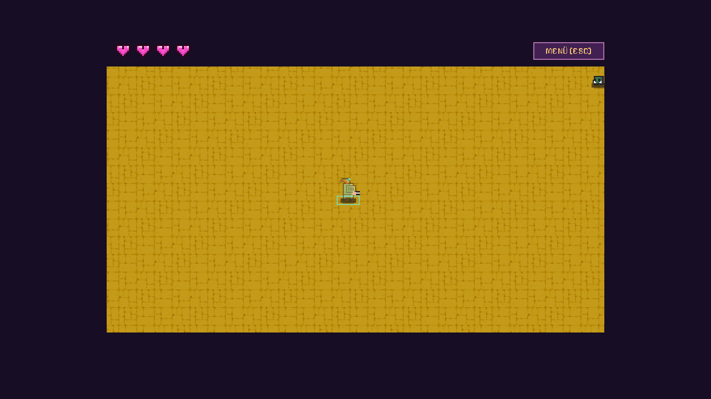
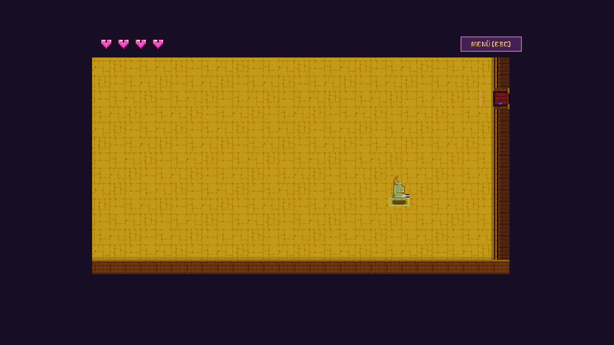

# Animationen, Sounds und Raumkamera

Stand26.10.2026, Entwicklungsbranch `codex_v2`. Das Spiel verwendet wieder ein
32×32-Weltraster. Die acht generierten Fallback-PNGs sind32×32. Die übernommenen
0x72-Frames aus dem Godot-Stand von `main` behalten ihre Originalmaße, etwa16×28
für Figuren, und werden ganzzahlig2× dargestellt. Ihre Lizenz steht unter
`assets/sprites/0x72/LICENSE-NOTE.md`.

Idle-/Lauf-/Trefferframes, Trefferpartikel, Todesfeedback und synthetisierte
Schuss-/Treffer-/Türsounds stammen aus diesem Stand. Der Treppenabstieg hat
zusätzlich einen eigenen absteigenden Sound. Die bestehende Perk-/Erkundungslogik
und maximal vier Spieler bleiben erhalten.

## Türen und Treppen

Nach Kampf, Perkauswahl und Bereitschaft bleibt der Raum begehbar. Lebende Spieler
sammeln sich am Ausgang; **E** startet den gemeinsamen Wechsel. Es folgen0,22s
Ausblenden nach Schwarz, mindestens0,08s Schwarz und0,22s Einblenden. Zeiten:
`src/data/balance.json` → `transition`.

Der Host hält während der Übergabe den Kampf an und wechselt den Raum unter
Schwarz. Jeder Client zeigt vor dem sichtbaren Raumtausch mindestens einen
vollständig schwarzen Frame und wartet gegebenenfalls auf den Zielzustand.
Übergangstoken verhindern wiederholte Sounds durch doppelte Snapshots.
Nach dem Boss führt die Innentreppe auf die nächste erzeugte Ebene.

## Sanfte Kamera

Die Kamera folgt dem eigenen Spieler und schwenkt höchstens24 Weltpixel zur
Maus. Kleine Räume erhalten nur eine leichte Folgebewegung; große Räume werden
durch ein896×480 großes Sichtfenster betrachtet. Ganze Pixelpositionen und
Nearest-Filterung vermeiden Glättung. Herzen, Menüs und Schwarzblende liegen
unabhängig von der Kamera. Zielen wird über den tatsächlichen Bildausschnitt
zurück in Weltkoordinaten umgerechnet.

`balance.json` → `camera`:

| Wert | Bedeutung |
| --- | --- |
| `follow_speed:5` | Exponentielle Annäherung pro Sekunde; höher folgt schneller |
| `look_ahead:24` | Maximaler Mausversatz in Weltpixeln |
| `small_room_follow:0.18` | Anteil der Folgebewegung in Räumen, die ins Sichtfenster passen |
| `edge_margin:32` | Erlaubter Bildrandversatz über die Raumgrenze hinaus |

Bei offenem Menü und während einer Schwarzblende bleibt die lokale Kamera ruhig.
Ein neuer Raum setzt die Kameraposition unter Schwarz zurück. Im Mehrspieler
bleibt das Informationsmenü weiterhin persönlich, die Welt läuft weiter.

## Prüfen

`tests/room_transition_test.gd`, `session_presentation_test.gd`,
`animation_feedback_test.gd` und `room_camera_test.gd` prüfen Darstellung und
Simulationsanbindung. `tests/transition_network_smoke.ps1` beobachtet fünf
gedeckte Wechsel über zwei Ebenen in zwei realen Prozessen. Der Vier-Prozess-Lauf
ist in `production/qa/verification.md` dokumentiert. Lokale Funktionsnachweise
ersetzen keine LAN-/WAN-/Latenz- oder Leistungsabnahme.
