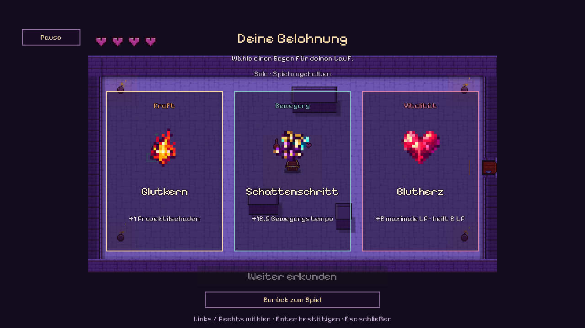
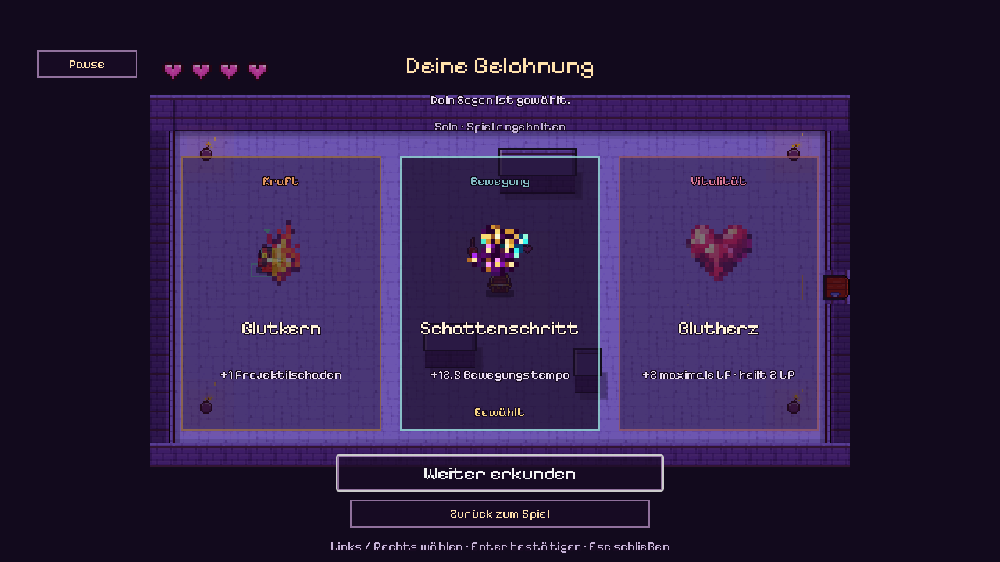

# Belohnungskarten und Pixel-Schrift

Nach dem Raumkampf erscheint die eigene Kartenansicht automatisch. Drei aufrechte,
halbtransparente Karten schweben vor der weiterhin sichtbaren Spielwelt.
Jede Karte zeigt ein großes Pixel-Symbol, den Perknamen und seine Wirkung.
Der Menüpunkt **Belohnung** führt ebenfalls zu dieser Ansicht.

- Mit der Maus eine Karte anklicken oder mit **Links/Rechts** wählen und mit
  **Enter** bestätigen. Tab navigiert ebenfalls zwischen den Schaltflächen.
- Nach der Bestätigung wird die gewählte Karte hervorgehoben. **Weiter erkunden**
  gibt die eigene Bereitschaft frei; alle lebenden Spieler müssen bereit sein.
- **Esc** oder **Zurück zum Spiel** schließt die Auswahl vorübergehend.
  Wiederöffnen erhält den bestätigten Perk. **Pause** öffnet die Informationen.
- Solo pausiert die Ansicht; im Mehrspieler läuft die Welt weiter. Der Raum
  wechselt nach der Auswahl weiterhin erst durch die gemeinsame Türinteraktion.

Der Host vergibt die tatsächlichen Perks. Bis zur Bestätigung bleibt die Auswahl
gesperrt; doppelte Klicks erzeugen keine zusätzlichen Belohnungen. Wiederholte
Netzwerkaktualisierungen setzen den Tastaturfokus nicht zurück.

## Symbole

Fünf neue Symbole wurden mit fünf separaten Aufrufen des eingebauten
**image_gen**-Werkzeugs erzeugt: Flammenkristall, verzauberte Stiefel,
Herzkristall, schnelle Armbrust und Mondtrank. Die Laufzeitdateien sind
normalisierte **16×16-RGBA-PNGs** mit echtem transparentem Hintergrund. Auf den
Karten erscheinen sie mit ganzzahligem6×-Zoom und Nearest-Filter.

Die gelieferten Originalatlanten bleiben erhalten. Generierte Originale,
vollständige Prompts und reproduzierbare Aufbereitung:
[assets/items/perks/README.md](../assets/items/perks/README.md).

## Schrift

**Pixel Operator8** ist die aktive Schrift in Spiel, Menüs, HUD, Artreferenz
und Dungeon-Baukasten. Sie hat proportionale Pixelbuchstaben mit deutschen
Umlauten. Die Schrift wird lokal mitgeliefert; Antialiasing und automatischer
Systemschrift-Fallback sind abgeschaltet. Es gibt keinen Laufzeit-Download.
16/24/32px passen zum nativen8px-Raster. Lange Kartennamen erhalten eine
passende gemeinsame Größe pro Angebot. Die unveränderte CC0-Lizenz und
Originalquellen liegen im [Schriftordner](../assets/fonts/README.md).
Die frühere Pixelify-Datei mit SIL-OFL bleibt als historische Quelle erhalten.
[Vollbild und aktuelles Review](UI-VOLLBILD-REVIEW.de.md).

## Prüfen

`tests/reward_cards_test.gd` prüft unter anderem getrennte Sichtbarkeit,
Transparenz, Tastaturwahl, echte Perkvergabe, verzögerte Bestätigung und Ready.
`./tests/pause_network_smoke.ps1 -RewardCards` lässt zwei echte Clients den
ersten Kampf gewinnen, unterschiedliche Karten auswählen und gemeinsam zur
freien Erkundung zurückkehren. Bildaufnahmen sind UI-Fixtures; dieser
Prozess-Smoke gewinnt den Kampf ausschließlich mit gewöhnlichen Bot-Eingaben.
