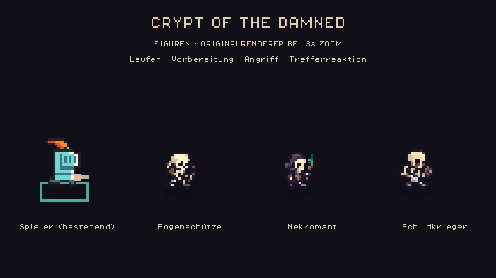

# Krypta-Stil und drei Untotenrollen

Stand:26.10.2026, Story022 auf `codex_v2`. Der Nutzer legt den vorhandenen
Krypta-Stil als gemeinsame Grundlage fest und priorisiert Figuren/Art vor der
späteren Balance- und Onlineabnahme.

## Verbindliche Art Direction

- Ruhiges32×32-Weltraster, ursprünglicher Schieferboden, klare erhöhte
  Mauerkanten, dunkle Außenfläche und warmes oranges Feuer.
- Dunkle violettgraue Konturen, wenige klar getrennte Farbstufen, Licht von
  oben links. Knochen warm elfenbeinfarben, Holz/Rüstung gedämpft braun,
  Nekromantenrobe dunkelviolett mit zurückhaltendem Türkis am Stab.
- Neue Untote nutzen dieselben2-Weltpixel-Blöcke wie die vorhandenen
  0x72-Figuren bei2×.36neue native32×48-Frames werden bei1× dargestellt;
  sichtbare Körper sind im kleinen bisherigen Gegnermaßstab30–36px hoch.
  Die alten Spieler- und Bossanimationen behalten ihre bisherigen Proportionen.
- Harte Transparenz und Nearest-Filter, keine geglätteten Konturen. Boden,
  Figuren, Effekte und UI behalten getrennte Aufgaben. Herzen bleiben oben
  links; Informationen/Inventar unter ESC, Belohnungen als transparente Karten.
- Hitstun/Rückstoß sind Hostspielregeln; Wobble, Idle-/Laufbewegung, Rückfederung,
  Trefferblinken, Partikel, Ton und Tod liegen im vorhandenen Feedbacksystem.
  Untote verlieren Knochenstaub statt der alten grünen Goblin-Partikel.

Raumkonturen, Originalbilder, eigener gespeicherter Dungeon, zehn Karten und
Boss10 sind erhalten. Neue Möbel, Nebel und Bodenmaterialien sind kein Teil
dieser Änderung. Die neuen Figuren sind zur persönlichen Sichtbewertung
bereit; der technische Nachweis ersetzt dieses Urteil nicht.

## Rollen im normalen Lauf

| Rolle | Verhalten | Erkennbare Öffnung |
| --- | --- | --- |
| Skelettbogenschütze | Hält Abstand, spannt den Bogen und verschießt einen gerichteten Pfeil. | Zielrichtung wird vor dem Schuss festgelegt; Vorbereitung und Flugzeit erlauben Ausweichen. |
| Nekromant | Wirkt langsamere Seelengeschosse; jeder dritte erfolgreiche Angriffszyklus kann einen Schildkrieger beschwören. | Längere Vorbereitung und ein Bodenzeichen zeigen den Zauber/Beschwörungsplatz. |
| Skelettkrieger mit kleinem Schild | Verfolgt den Spieler, reduziert frontale direkte Treffer auf35% und führt einen vorbereiteten Hieb aus. | Rücken, Angriffsvorbereitung/Erholung, Hitstun und Frost öffnen den Schutz; Gift/Feuer/Fläche umgehen ihn. |

Die ersten beiden Räume führen Schildkrieger und Bogenschützen ein. Ab Raum3
kommt höchstens ein Nekromant pro Raum hinzu. Mischungen sind seed-basiert.
Raum10 enthält weiterhin genau den bestehenden Boss mit zwei unterschiedlichen
Begleitern. Kein weiterer Boss wird durch Beschwörung erzeugt.

Ein Nekromant beschwört höchstens zwei Skelette insgesamt, mit maximal zwei
gleichzeitig lebenden eigenen Beschwörungen. Maximal zwölf Gegner dürfen
gleichzeitig leben. Der Host verlangt einen lebenden Nekromanten, Kampfphase,
freie erreichbare Bodenfläche,32px Mindestabstand zu anderen Gegnern und
mindestens112px Abstand zu lebenden Spielern. Blockierte Seitenplätze werden
vor der Vorbereitung verworfen; der Nekromant verwendet dann seinen Seelenzauber.

Pfeile und Seelengeschosse benutzen die vorhandene kontinuierliche
Geschoss-Treffererkennung, inklusive Wänden. Die Vorwarnlinien sind reine
Darstellung. Schaden, Beschwörung, Block und Treffer kommen ausschließlich
vom Host; Clients übernehmen Rolle, Zielbindung und Ereigniszähler.

## Animationen und Herkunft

Jede Rolle besitzt vier Idle-, vier Lauf- und vier Angriffsframes. Windup,
aktiver Angriff und Erholung wählen die passenden Bilder anhand der Hostphase.
Der gemeinsame Fußanker endet bei y46; der Renderer gleicht die zwei unteren
transparenten Zeilen aus. Vorbereitete Alphamasken liefern Trefferblinken,
ohne Texturen pro Frame neu aufzubauen. Tod und Wobble verwenden dieselben
Feder-/Posenregeln wie die bestehenden Figuren. Schildblöcke haben einen
eigenen warmen Funken-/Blitzimpuls und werden nicht je Netzsnapshot wiederholt.

Die Bilder wurden im **eingebauten Imagegen-Modus** aus den vorhandenen
Figuren als Stilreferenz erzeugt. Originale, exakte drei Prompts, Importer und
Palette sind im Projekt gespeichert:
[Assets, Prompts und Provenienz](../assets/sprites/crypt_enemies/PROVENANCE.md).
Die Quellen der bisherigen0x72-Grafiken und deren Lizenznotizen bleiben erhalten.

`src/art_reference.tscn` mit F6 öffnet die aktualisierte Stilwerkstatt. Sie zeigt
die neuen Gegner neben den bestehenden Spielern, einschließlich demonstrierter
Angriffs-/Trefferanimationen. Der Farbwechsel zu historischen gesättigten
Paletten ist dort für den festgelegten Stil deaktiviert.

## Daten und Code

`src/data/balance.json` enthält `enemy_roster.schema_version=1`:

| Bereich | Felder / Einheit |
| --- | --- |
| `definitions` | Stabile Rollen-IDs; `display_name`, HP/zusätzliche HP je Spieler, Weltpixel/s, Kollisionsradius, Angriffsart, bevorzugte/minimale/maximale Reichweiten und erste Abklingzeit. |
| `attacks` | `arrow/soul/summon/slash`; Vorbereitung, aktive Phase, Erholung und Abklingzeit in Sekunden. Geschossradius/-tempo/-lebensdauer, Nahkampfreichweite/-winkel und Schaden. |
| `encounter` | Einführungsraum, Nekromantenlimit, Beschwörungstakt sowie Rückzugs-/Pfadparameter. |
| `limits` | Gegner-/Beschwörungsgrenzen, Fehlversuche und sichere Abstände in Weltpixeln. |

Basiswerte: Bogenschütze7LP, Nekromant12LP, Schildkrieger11LP; Spielerzahl und
Ebene skalieren HP über die bestehenden Regeln. Die Vorbereitung beträgt
0,65s/Pfeil,0,9s/Seelenzauber,1,2s/Beschwörung und0,48s/Hieb. Diese Werte sind
eine erste spielbare Abstimmung, keine abgeschlossene Langzeitbalance.

`crypt_enemy_ai.gd` entscheidet Bewegung/Angriffe, `game.gd` prüft Schaden und
Beschwörung, `crypt_enemy_sprites.gd` lädt Frames, `dungeon_view.gd` zeichnet
Figuren/Telegraphen/Geschosse und `vfx/feedback.gd` reagiert auf die Zähler.
Protokoll und Regeln sind auf3/3 erhöht. Neue Felder sind Rollenname,
Angriffsart/-dauer, gelockte Zielrichtung/-position, Blockzähler,
Beschwörungszähler/-zuordnung sowie Geschossstil/-radius/-richtung.

Die Perks bleiben wirksam. Der zusätzliche Schild-/Überschuss-Regressionsfall
sichert, dass Überschussschaden nur nach einem echten tödlichen Treffer aus
dem tatsächlichen Schaden nach Schildreduktion entsteht.

## Gezielte Nachweise

- AI171/0, Spielintegration127/0, Assets/Feedback82/0, Schild/Überschuss4/0.
- Bestehende Perk-Kampfprüfungen100/0 und Feedback19/0.
- Zwei echte lokale Prozesse replizieren Rollen, gelockte Angriffe, Block,
  Beschwörung und Geschossstil in einer ausdrücklich eingerichteten Testszene.
- Tatsächliche GPU-Aufnahmen im Originalrenderer; die Animationsvorschau zeigt
  eine bewusste Design-Demonstration bei3×Inspektionszoom. Die normale Werkstatt
  zeigt den Stil bei normaler Größe. Keine gespielte Kampagnen-/LAN-/FPS-Abnahme.

[Prüfdaten und Quellprüfsummen](../production/qa/evidence/story-022-crypt-enemies/summary.json),
[Zwei-Prozess-Fixture](../production/qa/evidence/story-022-crypt-enemies/network.json).

Wiederholen: Godot4.7.2 mit `--headless --path . --script` und
`res://tests/crypt_enemy_ai_test.gd`, `crypt_enemy_integration_test.gd`,
`crypt_enemy_visual_test.gd` oder `crypt_enemy_perk_guard_test.gd`.
Die Netzwerkfixture startet `./tests/crypt_enemy_network_smoke.ps1`.
