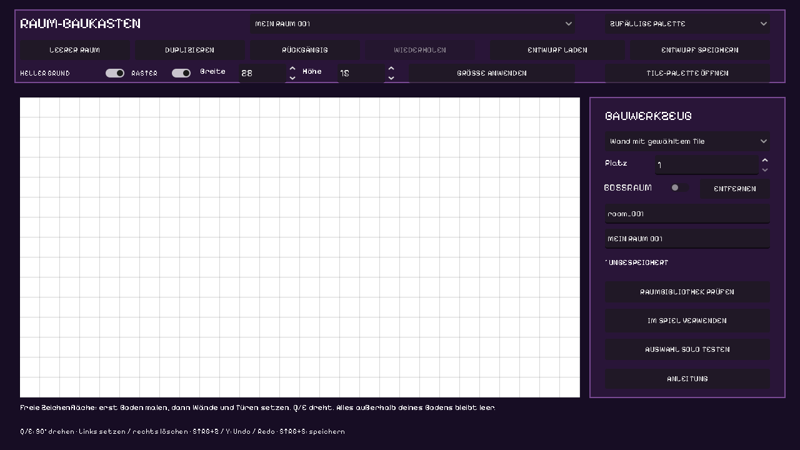
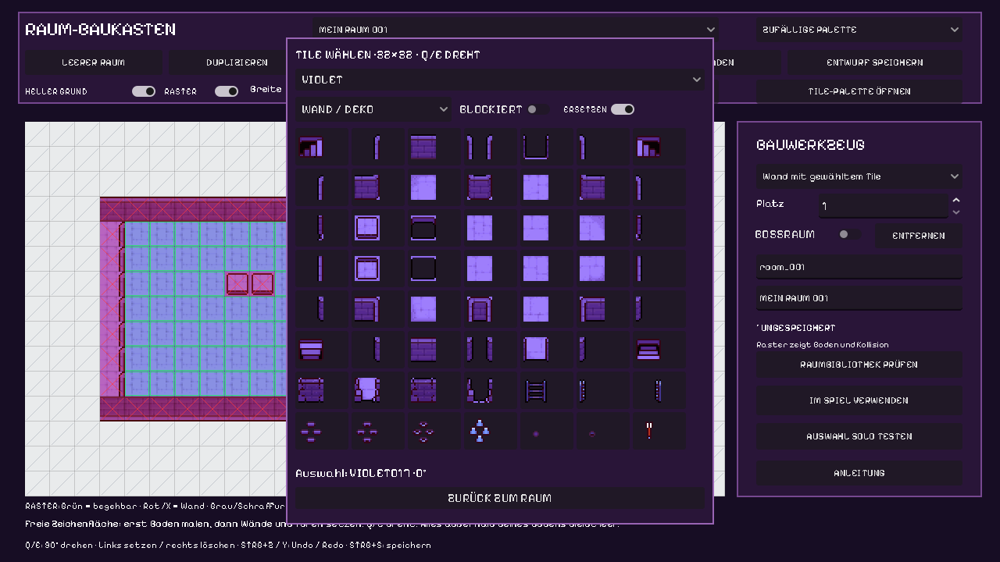
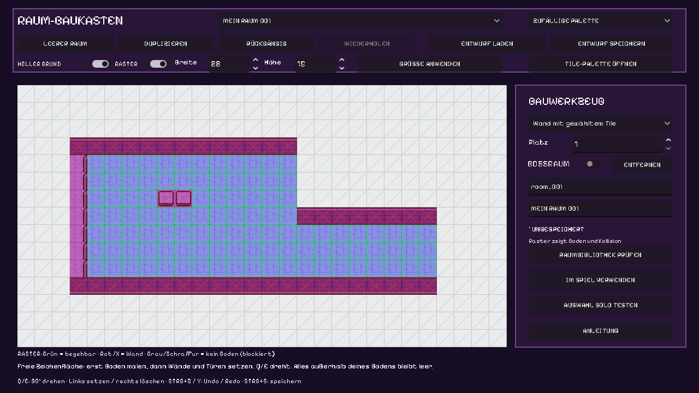
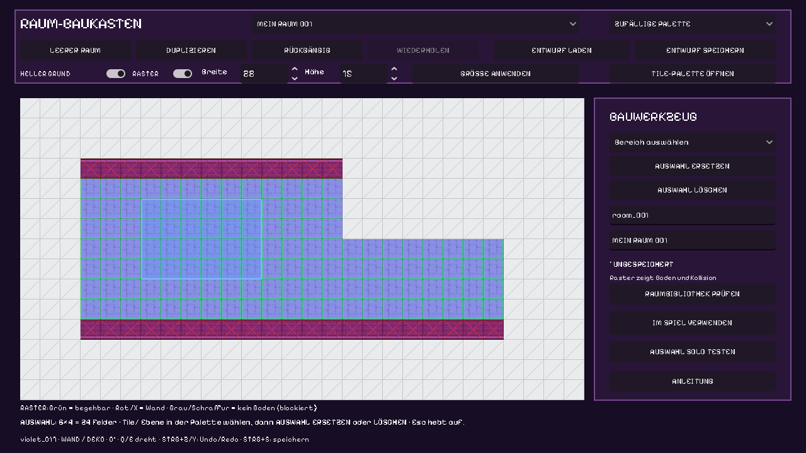
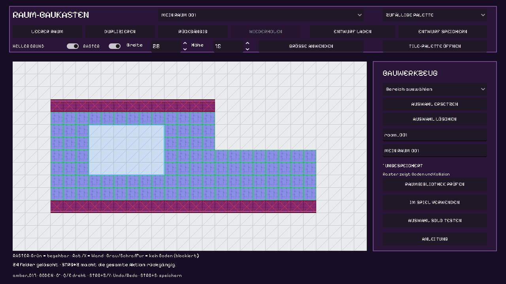
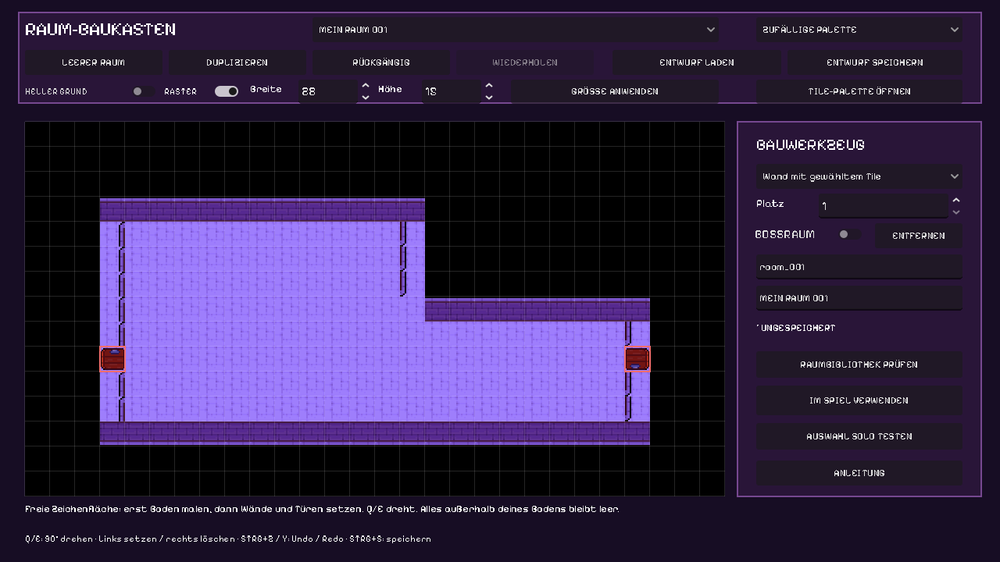

# Dungeons auf einer freien Zeichenfläche bauen

## Direkt den ausgewählten Raum spielen

Rechts **AUSGEWÄHLTEN RAUM SPIELEN** wählen. Der Editor startet genau die aktuelle
Auswahl einschließlich ungespeicherter Tiles und Begehbarkeitsfelder. Eine fertige
Raumbibliothek oder passende Nachbartüren sind dafür nicht nötig. Die normalen
Kampf-, HP-, Kamera- und Belohnungsregeln gelten im Einzelraum. Oben führt
**ZURÜCK ZUM DUNGEON-EDITOR** zurück; auch der Menü-Ausstieg kehrt zum Entwurf zurück.
Neustart lädt denselben ausgewählten Raum, keine neue prozedurale Variante.

Fehlende sichere Startplätze werden nur in der Vorschau ergänzt. Ganz ohne
begehbaren Boden gibt es eine konkrete Meldung statt eines kaputten Spielstarts.
Bodenähnliche Grafiken als WAND/DEKO zählen weiterhin nicht als gemalter Boden;
bei Bedarf die Fläche mit **BEGEHBAR MACHEN** freigeben. Diese Funktion verändert
beim Start keine gespeicherte Datei und übernimmt nichts automatisch ins Spiel.

Neue Palette **LIVING**:16animierte Krypta-/Gartenobjekte. Sie wählen beim Anklicken
nicht blockierende Deko und schalten ERSETZEN aus, damit der Boden erhalten bleibt.
Pflanzen und Effekte animieren bereits auf der Zeichenfläche. Gefäße/Sockel werden
statisch dargestellt. Neue Steintiles passen die vier vorhandenen Tile-Paletten
an die Requisiten an; IDs und Wandformen bleiben erhalten.

Stand:26.10.2026. **LEERER RAUM** beginnt vollständig leer: kein Boden,
keine Außenmauer, keine vorgegebenen Türen und keine automatisch gesetzten Figuren.
Du bestimmst den Grundriss selbst auf dem32×32-Raster. Der Generator kombiniert
die fertigen Raumvorlagen anschließend zu zufälligen Dungeons.

## 1. Öffnen und Zeichenfläche einstellen

`Dungeon-Editor.cmd` doppelklicken oder `./scripts/Dev.ps1 DungeonEditor` starten.
Der Starter öffnet eine neue leere Vorlage. In Godot kannst du auch
`src/dungeon_editor.tscn` öffnen und F6 drücken; dort **LEERER RAUM** anklicken.
F5 startet weiterhin das Hauptspiel.

Oben **Breite/Höhe** in Feldern einstellen, dann **GRÖSSE ANWENDEN**.
Die Zeichenfläche umfasst12–64 ×10–48 Felder à32 Pixel. Der gesamte Bereich
bis zu allen vier Rändern ist nutzbar. Du musst ihn nicht vollständig ausfüllen:
L-Formen, Nischen, schmale Verbindungen und freie Außenkonturen entstehen durch
deinen gemalten Boden. Jede Vorlage kann andere Maße haben.

**HELLER GRUND** schaltet zwischen weißem und schwarzem Hintergrund um.
**RASTER** blendet die Hilfslinien aus oder ein. Diese beiden Einstellungen
ändern nur die Ansicht; ein weißer Hintergrund erzeugt keinen begehbaren Boden.

Bei eingeschaltetem Raster siehst du zusätzlich die Kollisionen:

- **Grüne Umrandung**: begehbarer Boden.
- **Rot mit X**: blockierende Wand.
- **Grau mit Schraffur**: keine Bodenfläche, ebenfalls blockiert.

Rechts zeigt der Editor den Zustand des Feldes unter der Maus. Die Farben
verschwinden zusammen mit dem Raster. Sie markieren die Boden-/Wandzellen;
ausreichende Gangbreite für die Figuren prüft weiterhin der Raumtest.

Eine Größenänderung verschiebt keine gesetzten Inhalte. Würden Tiles, Türen,
Startpunkte oder Ausstattung abgeschnitten, erscheint eine Meldung.
Rückgängig stellt die vorherigen Maße wieder her.

## 2. Grafik und Ebene auswählen

1. **TILE-PALETTE ÖFFNEN** anklicken.
2. Das Sheet wählen: `VIOLET`, `ROSE`, `MOSS`, `AMBER` oder `ITEMS`.
3. **BODEN** für begehbare Flächen oder **WAND / DEKO** für darüberliegende Grafik wählen.
4. Bei Wand/Deko **BLOCKIERT** einschalten, wenn die Figur dort nicht durchgehen soll.
5. Eine Grafik anklicken. Danach ist der Tile-Pinsel aktiv.

**ERSETZEN** ist standardmäßig eingeschaltet: Ein neues Tile lässt sich direkt
auf ein bereits gesetztes Feld malen. Beim Ersetzen durch Boden werden Wand,
Tür oder Treppe an diesem Feld entfernt, damit die neue Grafik sichtbar wird.
Neue Wand-/Dekografik behält den Boden darunter. Das funktioniert auch mit den
Säulenzellen älterer Vorlagen. Jeder Pinselstrich ist gemeinsam rückgängig.

Schalte **ERSETZEN** aus, um ausschließlich die gewählte Ebene zu verändern,
zum Beispiel den Boden unter einer vorhandenen Wand. Startplätze, Feuer und
Truhen bleiben beim Tile-Ersetzen erhalten. Rechtsklick löscht wie bisher auf
der ausgewählten Ebene.

**Q/E** dreht die Auswahl um90° in beide Richtungen. Die aktuelle Richtung
steht beim Pinsel. Linksklick setzt, gedrückt ziehen malt, Rechtsklick löscht
auf der gewählten Ebene. Mit **STRG+Z/Y** machst du einen ganzen Pinselstrich
rückgängig oder wiederholst ihn.

Die Palette enthält280 separat gespeicherte32×32-PNGs unter
`assets/tilesets/cells32/`. Es sind ohne Glättung vergrößerte16×16-Zellen aus
deinen gelieferten Sheets; die vollständigen Originale bleiben unverändert.

## Ganze Flächen löschen oder ersetzen

1. Rechts im Bauwerkzeug **Bereich auswählen** wählen.
2. Mit gedrückter linker Maustaste ein Rechteck aufziehen. Die blaue Markierung
   zeigt die gesamte Auswahl; unten steht ihre Größe.
3. **AUSWAHL LÖSCHEN** entfernt die gewählten Tiles. Alternativ **Entf** oder
   **Rücktaste** drücken.
4. Zum Ersetzen zuerst in der Palette Tile, Ebene und Q/E-Richtung wählen,
   anschließend **AUSWAHL ERSETZEN** anklicken. Die Auswahl bleibt beim Öffnen
   der Palette erhalten; das neue Tile füllt den ganzen markierten Bereich.

**STRG+A** markiert die ganze aktuelle Zeichenfläche. **Esc** oder Rechtsklick
hebt die Markierung auf. **STRG+Z** macht die gesamte Flächenaktion mit einem
Schritt rückgängig; **STRG+Y** stellt sie wieder her.

Mit **ERSETZEN** an werden beim Löschen beide Tile-Ebenen sowie Türen/Treppen
in der Auswahl entfernt; mit ausgeschaltetem Schalter nur die gewählte Ebene.
Beim Füllen durch Boden werden verdeckende Wand-/Tür-/Treppengrafiken entfernt.
Startplätze, Feuerstellen und Truhe bleiben erhalten und lassen sich über ihre
eigenen Werkzeuge ändern. Außerhalb der Auswahl bleibt alles unverändert.
In älteren Rechteckvorlagen bleibt der automatisch vorgegebene Außenrahmen bestehen.

## 3. Den Grundriss selbst malen

Zuerst Boden auf die gewünschten Felder malen. **Alles ohne Boden bleibt leer
und im Spiel unbegehbar.** Der Editor ergänzt weder einen Außenrahmen noch
fehlende Flächen. Löschen auf der Bodenebene stellt diesen leeren Zustand wieder her.

Danach Wände auf der Ebene **WAND / DEKO** setzen. Boden und Wand dürfen auf
demselben Feld liegen: Die Wandgrafik zerstört den darunterliegenden Boden nicht.
Mit **BLOCKIERT** erhält die Wand ihre Kollision. Ohne diesen Schalter bleibt
sie Dekoration. Das Werkzeug **Wand mit gewähltem Tile** malt immer blockierend;
**Boden mit gewähltem Tile** malt immer Boden.

Die abgebildete Form ist eine manuell aufgebaute Editor-Demonstration. Jeder
Boden- und Wandbaustein sowie beide Türen sind einzeln gesetzt.
Lass begehbare Flächen zusammenhängend und Gänge mindestens zwei Felder breit,
damit auch der Boss Platz hat. Die Prüfung meldet getrennte Bodeninseln und
nicht erreichbare Startplätze.

## 4. Echte Türen und den Abstieg setzen

In der Palette die gewünschte Türgrafik wählen, dann das Werkzeug **Tür frei setzen**.
Mit Q/E die Richtung wählen: oben, rechts, unten, links. Linksklick setzt die
Tür genau am angeklickten Feld; Rechtsklick entfernt sie. Die Position ist nicht
an den Zeichenflächenrand oder eine gemeinsame Mittelachse gebunden.

Eine Tür schneidet an ihrem Feld die darüberliegende Wand weg. Sie erfindet
keinen Boden: Male den Boden darunter und den Zugang selbst. Innen vor der Tür
muss genug freie Fläche für vier ankommende Spieler sein. Unbrauchbare Ausgänge
werden in der Vorschau rot markiert.

Der Generator verbindet passende Gegenrichtungen, etwa Ost mit West. Er fügt
keine fehlenden Türen hinzu. In der Vorschau siehst du deine gesetzten Ausgänge;
im Spiel werden daraus die für die tatsächliche Route benötigten Verbindungen.
Eine Türgrafik, die du lediglich als Wand/Deko platzierst, ist nur Grafik.

Für die nächste Ebene **BOSSRAUM** aktivieren, eine Treppengrafik auswählen und
**Treppe setzen (Boss)** verwenden. Auch Grafik, Richtung und Position stammen
von deiner Auswahl. Rechtsklick entfernt den Abstieg vollständig. In freien
Vorlagen wird keine Ersatztreppe automatisch erzeugt.

## 5. Startplätze und Ausstattung

Mit **Spielerstart setzen** P1–P4 und **Gegnerstart setzen** E1–E5 einzeln auf
deinem Boden setzen. **Platz** wählt die Nummer. Beginne bei1; übersprungene
Nummern erzeugen keine zusätzlichen Positionen. Erneutes Setzen verschiebt einen
Platz, Rechtsklick entfernt ihn und schließt die Nummernlücke.

Die Startmarkierungen erscheinen beim passenden Werkzeug. Alle neun Positionen
müssen für die Spielübernahme frei und erreichbar sein; der Boss startet auf E1.

Feuerstellen und eine optionale Belohnungstruhe werden über ihre Werkzeuge
gesetzt und per Rechtsklick entfernt. Ein neuer freier Raum enthält keine davon.
Die persönliche Perkauswahl nach dem Kampf funktioniert unabhängig von der Truhe.

## 6. Vorlagen, Entwürfe und Spielübernahme

Oben wechselst du zwischen den Vorlagen. **DUPLIZIEREN** kopiert den gewählten
Raum, **LEERER RAUM** beginnt ohne Inhalt. Rechts legst du ID, Namen und Bossstatus
fest. IDs verwenden Kleinbuchstaben, Zahlen und Unterstriche und beginnen mit
einem Buchstaben. **ENTFERNEN** löscht die Vorlage rückgängig aus der Bibliothek.

**ENTWURF SPEICHERN** sichert auch unfertige Arbeit; **ENTWURF LADEN** stellt sie
wieder her. STRG+S öffnet den Speicherdialog. Maximal64 Vorlagen und2MB pro Datei.
Die Undo-Historie hält64 Änderungen dieser Sitzung und ersetzt das Speichern nicht.

**RAUMBIBLIOTHEK PRÜFEN** prüft Boden, Kollisionen, Spawns und deine Ausgänge.
Die Bibliothek benötigt mindestens drei normale Vorlagen und einen Bossraum.
Die vorhandenen Vorlagen dürfen erhalten bleiben. **AUSWAHL SOLO TESTEN** sucht
eine passende Testfolge mit deinem Raum. Bei einem Fehler bleibt der Editor offen.
Der Rückkehrbutton beendet den lokalen Test und erhält deinen Entwurf.

**IM SPIEL VERWENDEN** ersetzt ausschließlich nach erfolgreicher Prüfung
`assets/data/dungeon_rooms.json`. Danach das Hauptspiel neu starten und einen
neuen Lauf beginnen. Der Host überträgt die gewählten Flächen und Türen an bis
zu drei weitere Clients. Der Editor legt die Vorlagen fest; der Generator wählt
daraus die verbundene Raumfolge.

Vor jedem Ersetzen wird der alte Inhalt unter `user://dungeon_editor/backups/`
gesichert. Unter Windows liegt das gewöhnlich in
`%APPDATA%\Godot\app_userdata\Basement Run\dungeon_editor\backups`.
Eine Sicherung kann über den Ladedialog geöffnet werden. Der Speicherdialog darf
die aktive Datei nicht an der Veröffentlichungskontrolle vorbei überschreiben.

## Vorhandene Räume und frühere Entwürfe

Ältere rechteckige Vorlagen behalten ihren bisherigen Boden, Außenrahmen und
Türspuren. **DUPLIZIEREN** bewahrt diesen Modus; **LEERER RAUM** verwendet den
neuen freien Modus. Bestehende16-Pixel-Entwürfe werden beim Laden im Arbeitsspeicher
auf32 Pixel umgerechnet; ihre Originaldateien bleiben unangetastet.

Es gibt weiterhin keine eigenen Fallenregeln oder beliebig importierten Sheets.
Die freie Raumkontur, Wandgrafik und Türposition bestimmst du jetzt selbst.
Technische Felder: [Datenformat](DUNGEON.de.md).
