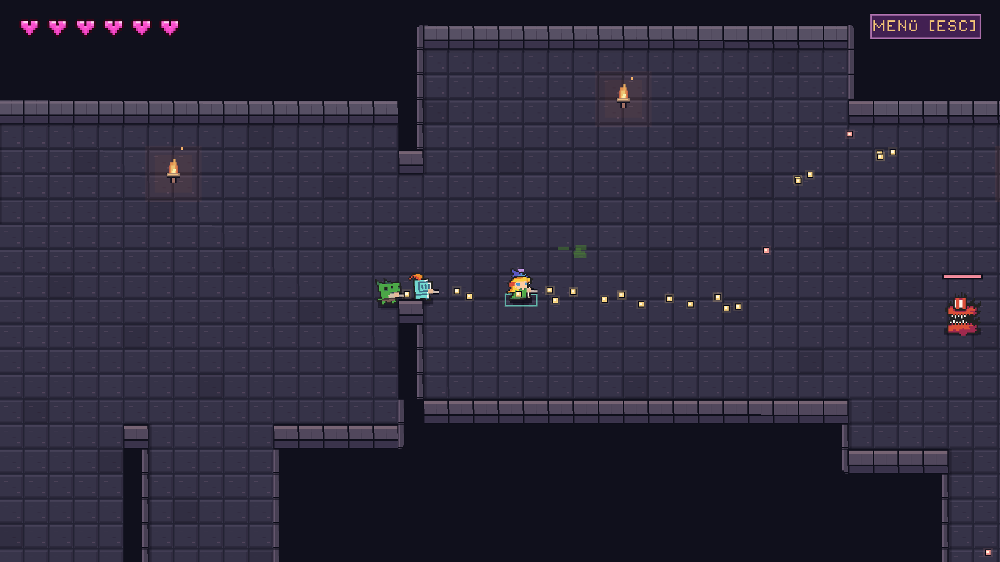

# GameDev-Schritte: Umsetzung und aktueller Nachweis

Stand:26.10.2026, lokal auf `codex_v2`. Die technischen Schritte aus dem
UI-/GameDev-Review sind umgesetzt und auf diesem PC geprüft. Ein zweiter
LAN-Rechner steht laut Nutzer noch nicht zur Verfügung. Stil und Spielgefühl
werden damit nicht stellvertretend als vom Nutzer akzeptiert markiert.

## Umgesetzt

- **Clientglättung:** Spieler, Gegner und Projektile mit stabilen IDs werden
  aus einem begrenzten Positionspuffer dargestellt. HP, Perks, Treffer und
  Raumzustand bleiben autoritativ. Keine Vorhersage oder endlose Extrapolation.
- **Saubere Grenzen:** Raum/Ebene/Lauf/Revision, Fade, Teleport, Tod und
  Wiederbelebung vermischen keine alten Positionen. Neue Bewegungspaare werden
  einmal auf geschnittene Mauerecken geprüft; der Renderframe wiederholt diese
  Kollision nicht. Auch Effekte eines Neustarts mit gleichem Seed werden geleert.
- **Versionsabgleich:** Protokoll-/Regelversion, Enginepatch, Generator sowie
  kanonischer Raum-/Balance-Hash werden vor Spieleraufnahme verglichen.
  Ungeprüfte oder abgewiesene Verbindungen erhalten keine Spielrechte.
  Fehler und Timeout werden lesbar angezeigt. Lobbyfarben bleiben auch nach
  mittlerem Abgang und Wiederbeitritt eindeutig.
- **Reproduzierbare Kampagnentests:** Die alte Drei-Raum-Annahme wurde aus den
  relevanten Tests entfernt. Bots steuern normale Eingaben, Kartenbuttons und
  physische Ausgänge; keine HP-/Schadens-/Teleport-/Raum-Cheats zählen als Lauf.

[Netzwerkschema und Konfiguration](NETZWERK-SITZUNG.de.md).

## Tatsächlich ausgeführte Prüfungen

| Prüfung | Ergebnis |
| --- | --- |
| Interpolation/Grenzen/Mauerecken |53 Prüfungen,0 Fehler |
| Protokoll-/Datenvergleich |20 Prüfungen,0 Fehler |
| Lobbyfarben nach Wiederbeitritt |5 Prüfungen,0 Fehler |
| Effekte bei festem Seed-Neustart |3 Prüfungen,0 Fehler |
| Aktuelle Spielregeln |24 Prüfungen,0 Fehler |
| Erkundung, Türen, Boss10 und Abstieg |85 Prüfungen,0 Fehler |
| Echte Aufnahmeprozesse |6 Rollen bestanden: Host, passend, Protokollabweichung, Datenabweichung, fehlerhaftes Hello und stiller Client/Host-Timeout |
| Vollständiger Solo-Lauf |PASS: zehn verschiedene Räume, Boss10, Rückweg, Treppe/neue Ebene |
| Zwei und vier unabhängige Prozesse |PASS: gleiche elf Layoutkennungen/-Hashes einschließlich neuer Ebene, persönliche Perks und gemeinsame Übergänge |
| Neustart nach verdientem Perk, zwei/vier |PASS: echter Perk in Raum1, alle in Raum2 regulär besiegt, Menü-Neustart mit Grundwerten, leerem Build und frischem Raum1/Ebene1 |
| Vier Prozesse mit UDP-Störung |PASS:50ms je Richtung, konfigurierte1% Datagrammverlustrate, vollständiger Lauf |

In den Kampagnen wurden Rückwege2→1→2 ohne doppelte Belohnung und zwölf
Tür-/Treppenwechsel mit jeweils einem Soundaufruf, Schwarzbild und Raumwechsel
geprüft. Die finale Störprüfung überwacht zusätzlich die tatsächlich gezeigte
View-ID/Revision gegen den freigegebenen Transition-Zustand.

Regel-Fixtures und neue Regressionen wurden vor Korrektur scheitern gesehen.
Die alten Regeltests erwarteten drei Räume beziehungsweise eine alte896px-Wand;
sie prüfen jetzt aktuelle Encounterdaten und eine explizite valide Testwand.
Frühere Testharness-Fehler beim erlaubten Run-Neustart wurden nicht als
Produktfehler umgedeutet. Auch leere Builds vor dem Wipe wurden nicht als
Nachweis zum Zurücksetzen verdienter Perks verwendet.

Die UDP-Testhilfe verändert keine OS-/Routereinstellungen. Gemessene Echo-RTT
war103,7–109,8ms bei nominal100ms. Im finalen Kampagnenlauf wurden357 von41009
Datagrammen verworfen (0,87%; konfigurierte Wahrscheinlichkeit1% je Richtung).
Keine Queue-Überläufe oder unerwarteten Transportfehler. Je ein aufgezeichneter
Windows-Port-geschlossen-Hinweis10054 beim regulären Ende ist separat ausgewiesen.

[Zusammenfassung und Quellprüfsummen](../production/qa/evidence/story-020-ten-room-coop-acceptance/acceptance-summary.json),
[Vierer-Störlauf](../production/qa/evidence/story-020-ten-room-coop-acceptance/impaired_four_peers.json),
[UDP-Bedingungen](../production/qa/evidence/story-020-ten-room-coop-acceptance/impaired_udp_fixture.json).

Abschließend wurden Godot-Import und13betroffene Spiel-/Testskripte ohne
Fehler geladen. Der persönliche Entwurf ist unverändert
(SHA256 `B8AFDCE111E0005407E1CE0BCF4427276EFED51CC987C65099671C82701BBF16`).

## Sichtbarer Vierer-Lauf und Bildzeiten

Ein sichtbarer echter Client wurde mit drei anderen lokalen Prozessen über alle
zehn Räume, Boss und Abstieg gespielt:1920×1080-Vollbild, RX6600, normaler
autoritativer Kampf, bis zu8Gegner/34Projektile. Nach2s anfänglichem Warmup:

- Dauer144,02s,20693Frames, durchschnittlich143,68FPS.
- Median6,96ms,95.Perzentil8,035ms; Bosskampf-p958,35ms.
- In jedem Raum blieb auch das Kampf-p95 unter16,667ms (vorgeschlagenes60FPS-Ziel).
-12615 Positionsschritte zwischen Netzpaketen zeigen die tatsächlich genutzte
  Zwischenbilddarstellung. Serverupdates bleiben20Hz.
- Größter Einzelwert97,191ms; der Lauf enthält Raumwechsel und diagnostische
  Screenshotaufnahme. Das ist keine Zusage, dass jeder Frame unter16,667ms liegt.

Die erste Messung mit kalter Testbotnavigation verfehlte das Ziel in Raum4.
Eine Callback-Diagnose fand31–87ms beim erstmaligen Wegaufbau des Testbots;
menschliche Clients verwenden diesen Autopilotpfad nicht. Draw-p95 in Raum4
lag bei0,863ms, Snapshotverarbeitung bei1,359ms. Der Testhelfer wärmt deshalb
seine privaten zehn Bot-Navigationsgraphen vor dem Beitritt vor (2228ms im
Abschlusslauf). Spielzustand, aktive Geometrie, Werte, Messfenster und harte
Grenzwerte blieben unverändert. Vorherige Fehlmessung und Diagnosedaten bleiben
erhalten; Frame-Pacing schwankte zudem zwischen Läufen. Ein einzelner Durchlauf
ist kein universeller Leistungsnachweis für jede Hardware oder jeden Seed.

[Bildzeiten je Raum und Warmupdaten](../production/qa/evidence/story-020-ten-room-coop-acceptance/visible-four-campaign/client-frame-times.json),
[vorherige Messung](../production/qa/evidence/story-020-ten-room-coop-acceptance/before-performance-fix/client-frame-times.json),
[Callback-Diagnose](../production/qa/evidence/story-020-ten-room-coop-acceptance/before-performance-fix/callback-diagnosis.json),
[UDP-Echoprüfung](../production/qa/evidence/story-020-ten-room-coop-acceptance/proxy-echo-check.json).



## Wiederholen

Im Repository mit der vorhandenen Godot4.7.2-Installation:

```powershell
./tests/session_protocol_smoke.ps1
./tests/ten_room_campaign_smoke.ps1 -Players 1
./tests/ten_room_campaign_smoke.ps1 -Players 2
./tests/ten_room_campaign_smoke.ps1 -Players 4
./tests/ten_room_campaign_smoke.ps1 -Players 4 -Scenario restart_after_reward
./tests/ten_room_impaired_smoke.ps1 -Players 4 -PythonPath <Python3-EXE>
./tests/client_render_probe.ps1 -Campaign
```

`<Python3-EXE>` ersetzen. Die Störhilfe verwendet nur die Python-Standardbibliothek.
Funktionsläufe sind headless; nur der Renderprobe-Client ist sichtbar und liefert
grafische FPS. Logs liegen unter `Logs/`; kompakte Nachweise sind oben verlinkt.

## Was noch offen ist

- Zwei echte LAN-Rechner und mindestens30Minuten echter LAN-Betrieb; ein
  Test über zwei Internetanschlüsse wurde ebenfalls nicht durchgeführt.
- Die persönliche Abnahme von Artstyle, Lesbarkeit, Steuerungsgefühl und Balance.

Der konkrete [LAN-Ablauf ist vorbereitet](LAN-ABNAHME.de.md). Ruhiger32px-Stil,
keine neue Raumdekoration, Schrift/Vollbild, zehn Karten/Boss10 und der persönliche
gespeicherte Dungeon sind erhalten. Keine Veröffentlichung oder Änderung auf main.

Run result: OBSERVED — echter sichtbarer Vierer-Kampagnen-/Bosslauf; Bilder und Rohdaten oben.
