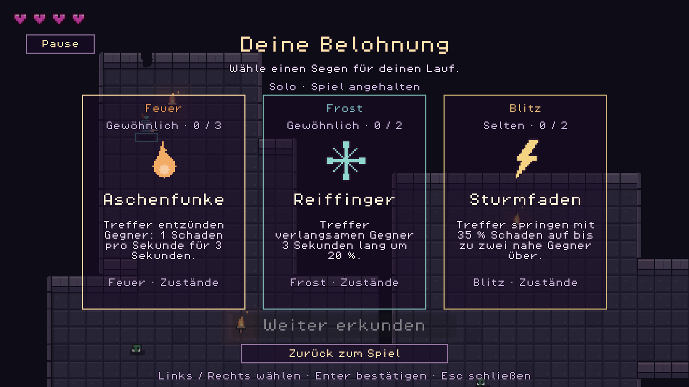
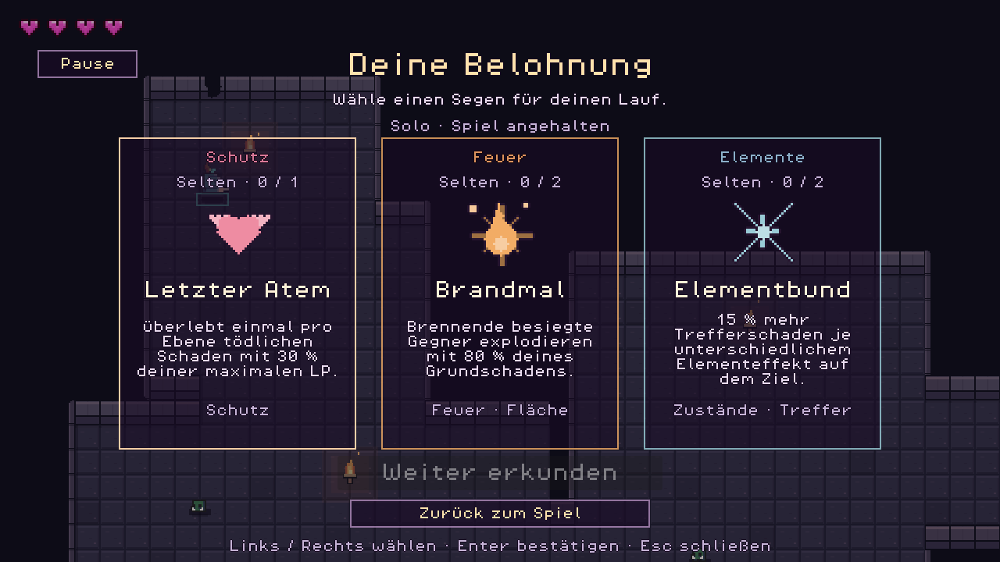
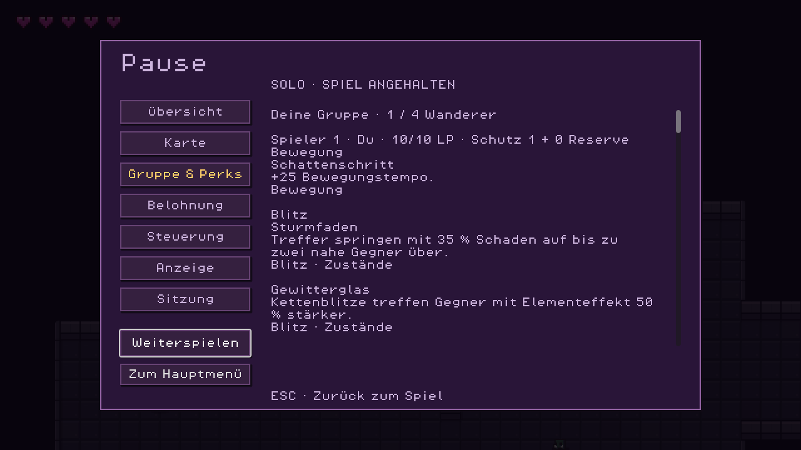
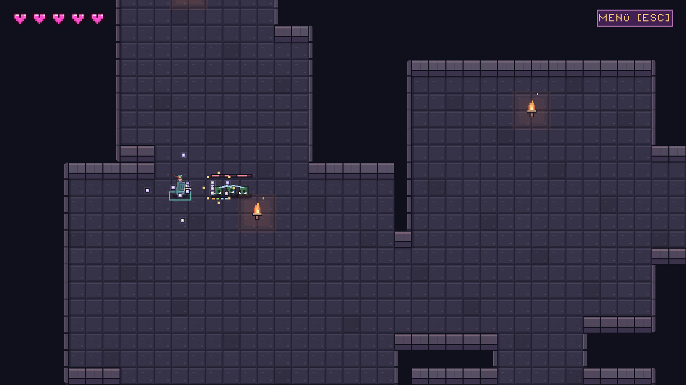

# Perks und kombinierbare Builds

Stand:26.10.2026, Story021. Der Katalog erweitert die fünf ursprünglichen
Werte-/Heilsegen auf **48 verschiedene Perks**. Alle werden im selben Lauf
kombiniert; es gibt keine festen Klassen oder vorgeschriebenen Sets.
Die vorhandenen drei transparenten Belohnungskarten bleiben die Auswahlfläche.

## Auswahl und Stapelung

Nach einem neu gesäuberten Kampfraum erhält jeder lebende Spieler ein eigenes
Angebot aus bis zu drei verschiedenen, vom Host bestätigten Karten. Die Wahl
verbraucht genau eine Raumbelohnung. Tote Spieler und besuchte gesäuberte Räume
erzeugen keine weiteren Angebote. Auswahl und Bereitschaft bleiben getrennt.

- Die Seltenheiten `common`, `uncommon`, `rare` besitzen die Grundgewichte
  1,0 /0,7 /0,38. Das sind relative Gewichte, keine festen Prozentchancen.
- Tags eines vorhandenen Builds erhöhen das passende Angebotsgewicht pro
  gemeinsamem Tag um35%, insgesamt höchstens100% zusätzlich. Andere Builds
  bleiben möglich; es gibt keinen Zwang, eine begonnene Richtung fortzusetzen.
- Erreichte Stapelgrenzen entfernen den Perk aus dem Angebot. Reine sofortige
  Heilung erscheint nur bei fehlenden LP.
- Reine Kombinationsverstärker setzen einen bereits nützlichen Ausgangsperk
  voraus: Eisbrecher/Wintersiegel benötigen Reiffinger, Pestsaat benötigt
  Gruftgift, Brandmal benötigt Aschenfunke. Alchemistenharz und Elementbund
  benötigen mindestens Feuer, Gift oder Frost. Gewitterglas benötigt Sturmfaden
  und mindestens einen dieser Elementeffekte.
- Wenn alle sinnvollen Perks ausgeschöpft sind, bleibt eine ausdrücklich
  gekennzeichnete **Seelenrast**: ein Schutztreffer bis zum Verbrauch,
  höchstens ein solcher Reserveschutz gleichzeitig. Das ist eine Notfallaktion,
  kein heimliches Weiterstapeln der48Perks und kein49.Katalogeintrag.

Die Effekte unten beschreiben einen Stapel. Wiederholbare Verstärker summieren
ihren Koeffizienten; Schnellfeuer multipliziert das Schussintervall je Stapel
mit0,85. Ein zusätzliches Blutherz heilt nur die tatsächlich hinzugekommenen
maximalen LP. Das erneute Berechnen eines Builds heilt nicht.

## Katalog

| Perk | Wirkung eines Stapels | Höchststapel |
| --- | --- | --- |
| GLUTKERN | +1 Projektilschaden. | 4 |
| SCHATTENSCHRITT | +25 Bewegungstempo. | 3 |
| BLUTHERZ | +2 maximale LP; heilt dabei 2 LP. | 4 |
| SCHNELLFEUER | 15 % kürzere Schusspause. | 4 |
| MONDTAU | Heilt bis zu 4 fehlende LP. Verbrauchbarer Segen. | Verbrauchbar |
| DORNNADEL | Schüsse durchdringen einen zusätzlichen Gegner. | 2 |
| SPIEGELSPLITTER | Schüsse prallen einmal zusätzlich von Wänden ab. | 2 |
| SCHROTSEGEN | Zwei schräge Zusatzschüsse: je 45 % Schaden, kürzere Reichweite. | 1 |
| BLEIKERN | 65 % mehr Schaden; 30 % längere Schusspause, langsamere schwere Schüsse. | 1 |
| ZWILLINGSLAUF | Zwei parallele Schüsse statt einem: je 65 % Schaden. | 1 |
| RÜCKENWACHE | Zusatzschuss nach hinten mit 65 % Schaden. | 1 |
| SEITENWACHE | Zwei seitliche Zusatzschüsse mit je 45 % Schaden. | 1 |
| IRRLICHTAUGE | Schüsse lenken zu nahen Gegnern; enge Kurven bleiben begrenzt. | 1 |
| MONDBOGEN | Schüsse fliegen in einer sanft schwingenden Bahn. | 1 |
| SCHARFBLICK | +12 % kritische Trefferchance; kritische Treffer verursachen 1,75× Schaden. | 3 |
| RUHEPOL | Im Stillstand 30 % mehr Projektilschaden. | 2 |
| LAUFFEUER | Während der Bewegung 20 % kürzere Schusspause. | 2 |
| HENKERSZEICHEN | 40 % mehr Trefferschaden gegen Gegner unter 30 % LP. | 2 |
| JÄGERMAL | Jeder weitere Treffer auf denselben Gegner erhöht den Schaden um 8 %, bis 100 %. | 2 |
| FERNSICHT | Bis zu 40 % mehr Trefferschaden mit wachsender Schussdistanz. | 2 |
| ASCHENFUNKE | Treffer entzünden Gegner: 1 Schaden pro Sekunde für 3 Sekunden. | 3 |
| GRUFTGIFT | Treffer vergiften Gegner: 0,8 Schaden pro Sekunde für 3 Sekunden. | 3 |
| REIFFINGER | Treffer verlangsamen Gegner 3 Sekunden lang um 20 %. | 2 |
| STURMFADEN | Treffer springen mit 35 % Schaden auf bis zu zwei nahe Gegner über. | 2 |
| EISBRECHER | 45 % mehr Trefferschaden gegen verlangsamte oder eingefrorene Gegner. | 2 |
| PESTSAAT | Vergiftete besiegte Gegner übertragen ihr Gift auf nahe Gegner. | 1 |
| BRANDMAL | Brennende besiegte Gegner explodieren mit 80 % deines Grundschadens. | 2 |
| GEWITTERGLAS | Kettenblitze treffen Gegner mit Elementeffekt 50 % stärker. | 2 |
| WINTERSIEGEL | Jeder vierte Frosttreffer friert 0,7 s ein; Bosse deutlich kürzer. | 1 |
| ALCHEMISTENHARZ | Brennen, Gift und Verlangsamung dauern 50 % länger, höchstens 8 Sekunden. | 2 |
| WÄCHTERSIEGEL | Blockiert pro neuem Kampfraum einen zusätzlichen Treffer. | 2 |
| DORNENHAUT | Nach erlittenem Schaden erleiden nahe Gegner 3 Vergeltungsschaden. | 2 |
| BLUTDURST | Jeder sechste selbst besiegte Gegner heilt 1 LP. | 1 |
| LETZTER ATEM | Überlebt einmal pro Ebene tödlichen Schaden mit 30 % deiner maximalen LP. | 1 |
| SEELENPANZER | Jeder vierte selbst besiegte Gegner lädt einen Schutztreffer auf. | 1 |
| RASTSEGEN | Ein neu gesäuberter Kampfraum heilt 1 LP. Rückwege geben keine Heilung. | 2 |
| ADRENALIN | Unter 35 % LP 25 % kürzere Schusspause. | 1 |
| ROTZORN | Unter 35 % LP 50 % mehr Projektilschaden. | 1 |
| STEINHAUT | Im Stillstand wird jeder zweite sonst erlittene Treffer vollständig blockiert. | 1 |
| NAHKAMPFSIEGEL | 35 % mehr Trefferschaden innerhalb von 110 Pixeln. | 2 |
| NACHHALL | Jede vierte Salve erzeugt eine zusätzliche Salve mit 50 % Schaden. | 1 |
| SPLITTERSAAT | Treffer spalten den Schuss einmalig in zwei Geschosse mit je 35 % Schaden. | 1 |
| SPRENGKERN | Treffer verursachen zusätzlich 30 % Flächenschaden; lösen keine Kettenreaktion aus. | 2 |
| BLUTNADEL | Jeder zwölfte direkte Projektiltreffer heilt 1 LP. | 1 |
| ÜBERSCHUSS | 60 % des überschüssigen tödlichen Schadens treffen nahe Gegner. | 2 |
| ELEMENTBUND | 15 % mehr Trefferschaden je unterschiedlichem Elementeffekt auf dem Ziel. | 2 |
| ERSTSCHLAG | 60 % mehr Trefferschaden gegen Gegner mit vollen LP. | 1 |
| NOTSCHUTZ | Nach erlittenem Schaden 0,4 s länger unverwundbar. | 2 |

Bei Effekten mit Schwellen (Blutdurst, Seelenpanzer, Blutnadel, Steinhaut)
ist der Koeffizient die feste Anzahl von Ereignissen bis zur Auslösung; diese
Perks sind deshalb auf einen Stapel begrenzt. Verbrauchbarer Mondtau kann bei
fehlenden LP erneut gewählt werden. Zahlen in den Karten sind die Spielregeln,
keine Aussage einer bereits durchgeführten langfristigen Balanceabnahme.

## Beispiele für frei kombinierbare Builds

| Richtung | Beispielkombination | Spielidee |
| --- | --- | --- |
| Hitzewelle | Aschenfunke + Brandmal + Sprengkern | Gruppen entzünden und brennende Gegner gezielt besiegen. |
| Frostjäger | Reiffinger + Wintersiegel + Eisbrecher | Gegner kontrollieren und die kurzen Frostfenster ausnutzen. |
| Gewittergruft | Gruftgift + Sturmfaden + Gewitterglas | Elementeffekte verteilen und Blitztreffer auf vorbereitete Ziele lenken. |
| Spiegelsaal | Spiegelsplitter + Dornnadel + Splittersaat | Wandwinkel und dicht stehende Gegner für besondere Flugbahnen nutzen. |
| Wanderer | Schattenschritt + Lauffeuer + Rückenwache | In Bewegung bleiben und Verfolger beim Ausweichen treffen. |
| Letzter Atem | Blutherz + Rotzorn + Adrenalin + Letzter Atem | Stärkere Kämpfe bei wenig Leben, mit begrenztem Sicherheitsnetz. |

Dies sind Kombinationen, die das System ermöglicht. Sie sind keine automatischen
Evolutionen oder zusätzliche Setboni. Die tatsächliche Wirkung ergibt sich
ausschließlich aus den gewählten Einzelperks und den beschriebenen
Elementwechselwirkungen.

## Daten und API

`src/data/balance.json` hält das versionierte Schema unter `perk_rules`
(`schema_version=2`) und den Katalog unter `perks`. Die alten fünf IDs
`ember/shadow/heart/quick/mend` bleiben erhalten.

Jede Definition benötigt:

| Feld | Bedeutung |
| --- | --- |
| `id` | Stabile eindeutige ASCII-Kennung. |
| `name`, `description` | Deutscher Kartenname und tatsächliche Wirkung. |
| `stat` | `damage/speed/max_hp/shot_interval/heal` für Grundwerte, sonst `effect`. |
| `amount` | Betrag je Stapel; bei Schussintervall ein Multiplikator. |
| `max_stacks` | Positive Höchstzahl;0 bedeutet verbrauchbar wiederholbar. |
| `rarity`, `weight` | Lesbare Seltenheit und positives relatives Angebotsgewicht. |
| `category`, `tags` | Lesbare Gruppe und Affinitäten des Builds. |
| `icon` | Stabile Iconnummer0..47, lokal auf dem Pixelraster dargestellt. |
| `requires_any` | Optional: mindestens eine der genannten IDs muss vorhanden sein. |
| `requires_all` | Optional: jede genannte ID muss vorhanden sein; gilt zusätzlich zu `requires_any`. |

`perk_rules` begrenzt Grundschaden auf16, Bewegung auf340Pixel/s, maximale LP
auf32 und die Schusspause auf mindestens0,06s. Die Konfiguration
`mechanics` enthält Kampfparameter in Sekunden, Weltpixeln oder dimensionslosen
Koeffizienten: unter anderem3s Elementdauer,0,5s Statustakt, höchstens8s Dauer,
100% Markierungsbonus,170px Blitzreichweite,70px Explosionsradius, vier
Frosttreffer bis zum Einfrieren und reduzierte Boss-Frostdauer. Projektil-
und Folgeeffektgrenzen verhindern unbegrenzte rekursive Effektketten.

`src/perk_rules.gd` ist eine injizierbare statische Regelhilfe:

- `initialize_player(player,balance)` erfasst Grundwerte einmalig.
- `rebuild(player,balance)` leitet Grundwerte und `player.build` neu ab,
  ohne alte Effekte zu verdoppeln oder Schaden wegzuheilen.
- `grant(player,definition,balance)` löst die ID gegen den Hostkatalog auf,
  prüft die Stapelgrenze und gewährt genau einen Effekt. Vom Aufrufer
  veränderte Schadensbeträge werden ignoriert.
- `offer(player,balance,rng,count=3)` erzeugt das persönliche Angebot als
  unabhängige Kopien und verändert den Katalog nicht.
- `find(balance,id)` und `stack_count(player,id)` lesen Definitionen und Besitz.

Kampflogik, Darstellung und Netzwerk bleiben getrennt: der Host berechnet die
Wirkungen, die Oberfläche beschreibt die bestätigten Angebote. Raumkonturen,
ruhige32px-Tiles und der gespeicherte persönliche Dungeon gehören nicht zu
dieser Änderung.

## Gezielte Regelprüfung

`tests/perk_rules_test.gd` enthält reine deterministische Regel-Fixtures sowie
eine lesende Prüfung des echten Katalogschemas. Geprüft werden idempotente
Ableitung, Heilung, Stapelgrenzen, kanonische Werte trotz manipuliertem Aufrufer,
unterschiedliche persönliche Karten, Voraussetzungen, reproduzierbarer Zufall,
begrenzte Affinität und der wirklich ausgeschöpfte Pool bei vollem Leben.

Letzter isolierter Regellauf: **667Prüfungen,0Fehler**. Ein fehlendes Regelmodul
wurde vor Implementierung scheitern gesehen. Eine zunächst unvollständige
Fallback-Fixture wurde auf tatsächlich volle LP nach allen Herzstapeln und den
expliziten Reserveeintrag korrigiert. Der Regeltest ersetzt weder einen
vollständigen Spiellauf noch eine Abnahme der langfristigen Balance.

## Umsetzung und Nachweise

Alle48IDs sind an echte Hostwirkungen gebunden.100 gezielte Kampfprüfungen
testen tatsächliche Muster, Treffer, Flugbahnen, Elementzustände, Schutz und
Heilung sowie mehrere Wechselwirkungen.159 UI-Prüfungen bestätigen unter
anderem48 unterschiedliche Iconbilder, Stapelanzeige und lesbare Karten.
Die neuen32px-Icons werden auf der1280×720-Designfläche mit3× dargestellt;
die fünf bisherigen Originalicons bleiben erhalten.

Bestehende Spielregeln24/0, Erkundung85/0, Clientinterpolation53/0 und
Versionsschema20/0 bleiben grün. Zwei echte lokale Prozesse bestätigen eigene
Angebote, Kartenwahl, Hostbestätigung, Ablehnung ungültiger/doppelter Wahl und
korrekte Inventare. Hier wurde der Belohnungszustand ausdrücklich eingerichtet;
das ist kein gespielter Lauf oder echter LAN-Test.

Geschosse sind global auf144 und je Spieler auf24 begrenzt;32Plätze bleiben
für Gegner reserviert. Höchstens9Basisgeschosse je Salve,24Folgewirkungen je
Kampftakt und32kurze sichtbare Ereignisse. Sekundäre Flächen-/Blitztreffer
erzeugen keine weiteren Trefferketten. Ein Projektil trifft dieselbe
Gegnerkennung höchstens einmal. Seelenpanzer-Ladungen bleiben über Türen
erhalten; Raum-Schilde und Rastheilung lassen sich nicht durch Rückwege farmen.
Neue Läufe setzen die Perks zurück, neue Ebenen behalten den Build.

Ein durch Dornen-Vergeltung getöteter Boss beendet auch in derselben
Simulationsiteration keinen bereits vorbereiteten Angriff mehr. Der neue
Regressionsfall wurde vor der Korrektur scheitern und danach bestehen gesehen.

Das persönliche Angebot und die neue Kampflogik führten Version2 ein. Mit den
neuen Krypta-Gegnern aus Story022 gelten inzwischen Protokoll/Regeln3/3.
Alte Clients werden abgewiesen. Die Zahlen sind eine erste
Balancefassung; der Nutzer bewertet Spielgefühl und langfristige Buildstärke.
Die früheren144FPS-Viererbelege gelten für den Stand vor diesem Perkausbau.
Auf Nutzerwunsch wurde hier keine neue Online-/LAN-/Lastkampagne gestartet.

[Ergebnisdaten und Quellprüfsummen](../production/qa/evidence/story-021-perk-builds/summary.json),
[Zwei-Prozess-Nachweis](../production/qa/evidence/story-021-perk-builds/network.json).

Die folgenden echten GPU-Aufnahmen zeigen eingerichtete Prüfzustände:
gezielte Angebote, ein für die Inventaransicht gewährtes großes Build und
simulierte Projektile/Statusanzeigen. Sie belegen keine regulär verdienten
Perks oder abgeschlossene Kampagne.






Wiederholen im Repository:

```powershell
godot --headless --path . --script res://tests/perk_rules_test.gd
godot --headless --path . --script res://tests/perk_combat_test.gd
godot --headless --path . --script res://tests/perk_ui_test.gd
./tests/perk_network_smoke.ps1
```

`godot` durch die vorhandene gepinnte Godot4.7.2-EXE ersetzen, falls nicht im PATH.
