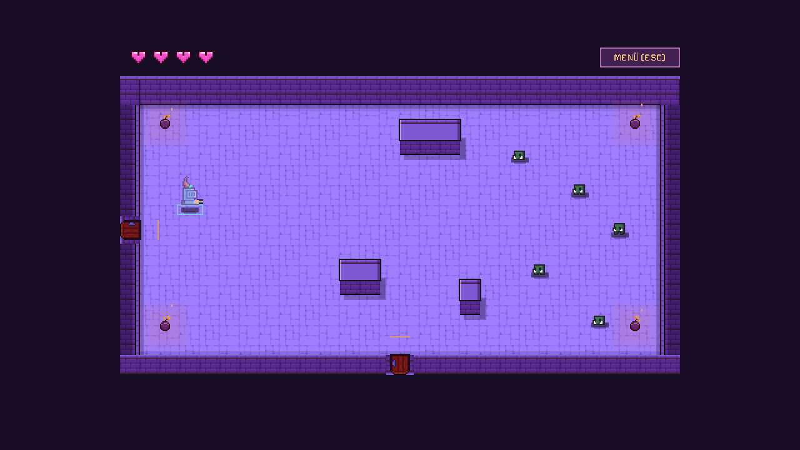
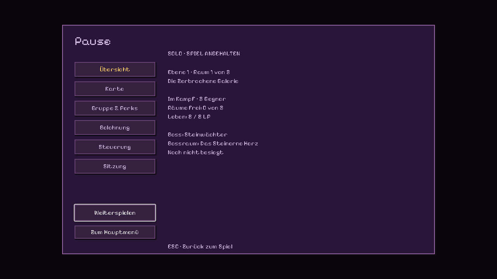
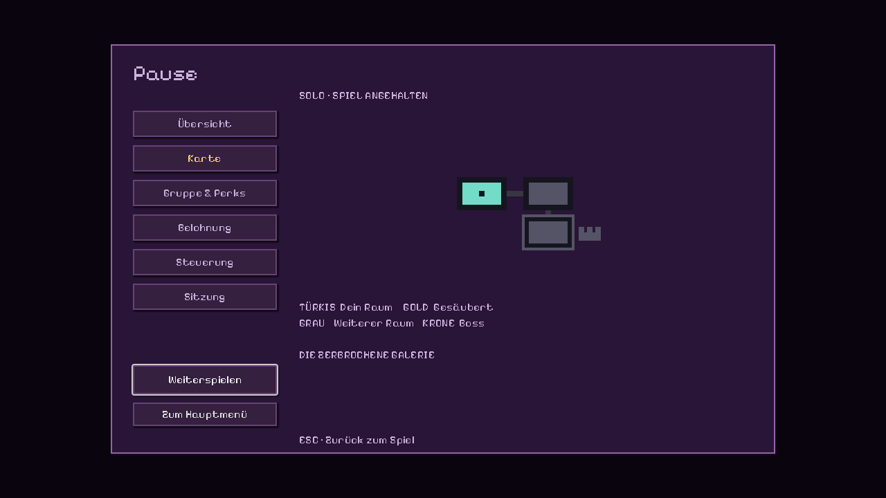

# Spielansicht und Esc-Menü

Im Spiel bleiben die eigenen Herzen oben links und ein kleiner **MENÜ [ESC]**-
Button. Die Welt nutzt die gesamte sichtbare Fensterfläche statt eines kleinen
mittigen Ausschnitts. Designbasis:1280×720 mit32px-Weltraster; andere
Seitenverhältnisse erweitern die Sichtfläche ohne Verzerrung. Herzen und Menü
bleiben oben am Bildschirmrand. Die Lobby ist eine zentrierte Komposition.

**F11**, **Alt+Enter** oder **ESC→Anzeige** wechseln zwischen Fenster und
Vollbild. Fenstergröße und Position werden bei der Rückkehr wiederhergestellt.
ESC öffnet weiterhin das Menü. Menüs und schwarze Raumblende decken auch
zusätzliche Sichtfläche vollständig ab.

**Esc** öffnet und schließt das Menü; **WEITERSPIELEN** schließt es ebenfalls.

| Menüpunkt | Inhalt |
| --- | --- |
| Übersicht | Ebene, Raumname, Phase, Gegner, gesäuberte Räume, genaue LP, Bossname/-raum/-status und aktuelle Boss-LP |
| Karte | Vergrößerte Raumverbindungen mit aktuellem Raum, gesäuberten Räumen und Bosskrone |
| Gruppe & Perks | Teilnehmer, LP, persönliche Perks und Bereitschaft; längere Listen sind scrollbar |
| Belohnung | Öffnet eine eigene transparente Kartenansicht mit persönlichen Perks und „Weiter erkunden“ |
| Steuerung | Bewegung, Schießen, Ausgänge und Spielablauf |
| Anzeige | Vollbild einschalten beziehungsweise zum Fenster zurückkehren |
| Sitzung | Host/Client, Port, Teilnehmerlimit, Lauf-/Ebenen-Seed und Generatorversion |

**Solo pausiert** das Menü Bewegung, Gegner, Projektile und Simulationstimer.
**Im Mehrspieler läuft die Welt weiter**; dein Charakter kann getroffen werden.
Das Menü zeigt diese Unterscheidung an. Netzwerkpolling bleibt in beiden Fällen
aktiv. Es wird kein globales `SceneTree.paused` gesetzt.

Bei offenem Menü sendet der lokale Spieler neutrale Bewegungs-/Feuerbefehle.
E löst keine Tür aus; Menü-Klicks erzeugen keine Schüsse. Nach dem Schließen
müssen gehaltene Maustasten zunächst losgelassen werden.

Nach dem Raumkampf erscheinen die Angebote automatisch als drei frei stehende
Karten. Esc schließt sie; im Menüpunkt Belohnung lassen sie sich erneut öffnen.
Perk wählen und **Weiter erkunden**
bestätigen. Wenn die Gruppe
bereit ist, schließt sich diese Ansicht; es gibt keinen automatischen Raumwechsel.
An Türen/Treppen erscheint nur ein kurzer E-Hinweis. Geschlossene Menüs erlauben
auch während der Belohnungsphase Bewegung.

**ZUM HAUPTMENÜ** beendet deine Verbindung. Geht der Host, endet der Lauf für
alle. Nach einem verlorenen Lauf kann der Host im Menü **NEUER LAUF** wählen.

Ein Herz bedeutet zwei LP. Ganze/halbe/leere Herzen bilden weiterhin eine
gemeinsame Grafik aus dem Originalsheet. Live werden bis zu zwölf Herzen mit3×-
Zoom gezeigt; ein Plus kennzeichnet weitere Kapazität. Genaue LP stehen im Menü.
Zusätzliche Spieler-LP-Balken und Ready-Marken entfallen im Hauptspiel;
Gegnerbalken bleiben als Kampffeedback. Die Artstyle-Werkstatt ist weiterhin
eine ausführlichere Grafikreferenz.

Der existierende Boss hat den konfigurierbaren Arbeitsnamen **STEINWÄCHTER**
(`boss.display_name` in `src/data/balance.json`). Bossname und Teilnehmerlimit
kommen im Hostsnapshot; der Bossraumname stammt aus der erzeugten Ebene.

Alle Spieloberflächen verwenden die gebündelte Pixel-Schrift **Pixel Operator8**.
16/24/32px passen zum nativen8px-Raster; Umlaute,ß und€ sind enthalten. Lange
Perk-Namen bekommen eine einheitliche passende Schriftgröße statt Wortzerstückelung.
Die Belohnungskarten zeigen große transparente Pixel-Symbole; die Welt bleibt
im Hintergrund sichtbar. [Karten, Bedienung und Grafikquellen](BELOHNUNGEN.de.md).

[Aktuelle Ansichten und Review](UI-VOLLBILD-REVIEW.de.md). Die folgenden Bilder
zeigen frühere Layouts und Schriftstände.

Prüfen: `Dev.ps1 Check`, `tests/pause_menu_test.gd` mit Godot sowie
`./tests/pause_network_smoke.ps1`. Der Prozess-Smoke öffnet die Menüs eines
echten Hosts und Clients und verlangt weitere Snapshots/Gegnerfortschritte
sowie neutrale Clientbefehle beim Host. LAN/WAN und Leistung bleiben offen.
