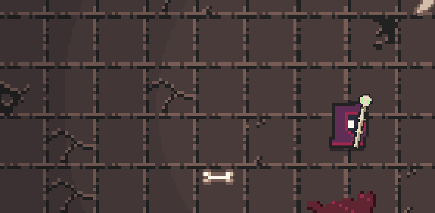

# Seelensog in den Nekromantenstab

04.11.2026. Basis: `ab181e4a`, lokaler Branch `codex_v2`.

Der bestehende bestätigte `souls`-Belohnungsevent zeichnet den vorhandenen
Seelengeist, einen kurzen Schweif und den Aufnahmeblitz am tatsächlich
gezeichneten Stab. Flugziel und Blitz folgen dem Helden auch zwischen
Host-Snapshots. Kein neuer Schaden, Ressourcentyp oder Netzwerkbefehl.

## Geprüft

- `tests/soul_absorption_test.gd`: **17 Prüfungen, 0 Fehler**. Bewegter Socket,
  richtiger Empfänger, Story-Schlüssel `hero`, veraltete/fehlende Pose,
  beide Kunstraster, Flug und Aufnahme, Ende, echte Todesbelohnung und
  Duplikatschutz. Gegen die alte Darstellung zunächst **1 erwarteter Fehler
  bei 5 Prüfungen** (`before.txt`): keine stabgebundene Aufnahme vorhanden.
- `tests/necro_souls_aggro_test.gd`: **89 Prüfungen, 0 Fehler**. Bestehende
  Seelenwirtschaft und Begleiterregeln, einschließlich Regeneration,
  Assist-Seelen, Beschwörungen, voller Leiste und Kampfzielauswahl.
- `scripts/capture_soul_absorption.gd`: **43 GPU-Bilder** der aktuellen
  Krypta-Laufzeit. Kontrollierte Gegner-Todesmeldung; der Held bewegt sich
  während der Aufnahme nach oben. Die Seelenleiste bleibt bei 8/100. Im Log
  erreichen Seele und Stab bei Bild 35 denselben Weltpunkt; Bild 42 hat keinen
  Aufnahmeeffekt mehr. Die beiden PNGs sind vollständige Rohbilder. Das GIF
  zeigt einen dreifach per nearest vergrößerten Ausschnitt dieser Aufnahme,
  mit Pause am Ende. Es ist kein neuer Entwurf und kein Kampagnen-Playtest.
- Godot 4.7.2, Compatibility, RX 6600. Keine `SCRIPT ERROR` oder Parsefehler
  in den abschließenden Prüfungen und der erfolgreichen Aufnahme.
- `git diff --check` für die bearbeiteten verfolgten Dateien: ohne Befund.

## Grenzen und vorhandene Meldungen

Die beiden Game-Fixtures melden beim Beenden 6 verbliebene ObjectDB-Instanzen
und 2 Ressourcen. Dieselben Meldungen traten bereits im Vorher-Lauf auf;
dieser Schritt behebt die bestehende Testbereinigung nicht. Der GPU-Prozess
meldet außerdem, dass er den Shadercache unter `user://` nicht anlegen kann;
die Aufnahme gelang trotzdem. Keine Aussage zur Vier-Spieler-Performance,
kein neuer echter Mehrprozess-/LAN-Test und keine Nutzerabnahme des Looks.

Speicherdateien der Fixtures sind getrennt vom Spielerprofil. Der endgültige
Test und die erfolgreiche Aufnahme räumen ihre eigenen Dateien auf. Die
anfangs zu streng gewählte freie Fläche der Aufnahme-Fixture wurde korrigiert;
das war kein Fehler des Laufzeit-Effekts. Keine Commits oder Pushes ausgeführt.

