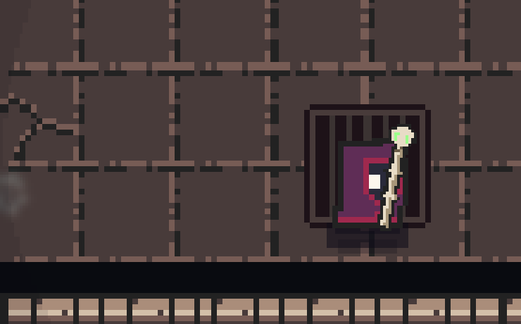

# Seelenkopf mit Augen und Pixelschweif

04.11.2026. Der Nutzer möchte die physikalische Aufnahme-Seele als kleines
Wesen mit Augen und Schweif erkennen. Gemeinsamer Partikellöser wie bei den
Leeren-Effekten; keine neue Bildgeneration, keine neuen Ressourcenbuchungen.

Ein normales simuliertes Kopfteilchen trägt eine aus Pixelzellen gezeichnete
7×7-Silhouette mit zwei dunklen Augen und kurzem Blinzeln. Sechs weitere
Teilchen bilden eine federgekoppelte Kette. Sie folgen der tatsächlichen
Geschwindigkeit des Vorgängers, während Wind, Druck und Sog weiter auf sie
wirken. Lose Pixel bleiben erhalten. Der Kopf wird innerhalb seines
Tiefenbands zuletzt gezeichnet, damit eigene Staubpixel die Augen nicht
übermalen; die Bloom-Stärke dieser Aufnahme-Teilchen ist reduziert.

Einstellungen und Einheiten: `assets/data/vfx_particles.json` / `soul`,
erläutert in `docs/SEELEN-MATERIE.de.md`. Kein separater Gesicht-Sprite auf
einer vorgegebenen Flugkurve. Der Kopf bleibt als lesbare Form zusammen;
seine einzelnen gezeichneten Gesichtszellen sind keine eigenen Physikkörper.
Der Schweif besteht aus eigenen simulierten Teilchen.

## Prüfung

- `soul_face_test.gd`: **7 / 0 Fehler**. Ein Kopf, begrenzte Schweifkette,
  Bewegung durch Simulation, Druckreaktion, begrenzte Geschwindigkeiten,
  kein Duplizieren bei bewegtem Stab, vollständiges Ende.
- `soul_matter_physics_test.gd`: **24 / 0 Fehler**. Bestehende Physik einschließlich
  Wind, Sog, Wänden, Ankunft und gemeinsamem Partikelbudget erhalten.
- `particles_physics_test.gd`: **26 / 0 Fehler**. Bestehende Partikelregeln.
- Vorher-Lauf des neuen Tests: **2 erwartete Fehler bei 3 Prüfungen**,
  weil Kopf und Schweifkette noch fehlten.
- Aktueller Krypta-Renderer: kontrollierte Todesbelohnung, bewegter Nekromant,
  43 Rohbilder. `close-08.png` zeigt offene Augen, `close-14.png` das kurze
  Blinzeln. Das GIF ist vierfach nearest-vergrößert und mit verlangsamter
  Wiedergabe; keine nachträglich gemalte Spielfigur.
- Keine Script-/Parsefehler in den abschließenden Läufen. Der bereits bekannte
  fehlende Shadercache-Zugriff unter `user://` wird bei der GPU-Aufnahme
  weiterhin gemeldet. Keine neue LAN-/Gesamt-FPS-Abnahme, noch kein Push.

