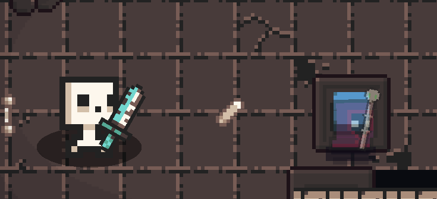

# Seele aus einem gefallenen Gegner

04.11.2026. Nutzerwunsch: Todesanimation und Austritt der Seele aus dem
Gegnerkörper gemeinsam mit dem Flug zum Nekromanten zeigen.

`scripts/capture_soul_from_corpse.gd` öffnet die tatsächliche Krypta-Laufzeit.
Ein kontrolliertes Skelett steht mit 0,5 HP und angehaltener Bewegung an einer
freien Stelle der generierten Karte. Nach kurzem Vorlauf feuert der
Nekromant einen normalen Klassenangriff. Die normalen Schuss-, Treffer- und
Monstersysteme erzeugen die Todesanimation, den Leichenkörper und genau einen
Seelenbelohnungs-Event. Es wird kein zusätzlicher Leichen-Sprite eingefügt.

150 Rohbilder bei manuell gesteuerten 60 Simulationsschritten/s. Tod bei Bild
52; Leichenkörper und physikalischer Seelenkopf wurden beobachtet, genau ein
`souls`-Event. Die Kamera ist für diese Aufnahme auf 2× gestellt. Das GIF
enthält einen Ausschnitt der Bilder 24–124 mit verlangsamter Wiedergabe und
Pause am Anfang/Ende. `scene-*.png` sind unveränderte vollständige Rohbilder.
Kein neuer Kampagnen-/Balance-Test, keine Änderung an den Spielregeln.

Die Aufnahme hat keine Script-/Parsefehler. Die Engine meldet den fehlenden
Shadercache-Zugriff und beim Beenden Textur-/ObjectDB-/Ressourcen-Leaks
(905 Texture-RIDs, 1385 ObjectDB-Instanzen, 29 Ressourcen). Diese Meldungen
wurden mit dieser Aufnahme nicht behoben; sie ist keine Cleanup-Abnahme.
Eigene Capture-Profildateien sind vom Spielerprofil getrennt und werden vom
Basisskript entfernt. Keine Commits oder Pushes ausgeführt.

