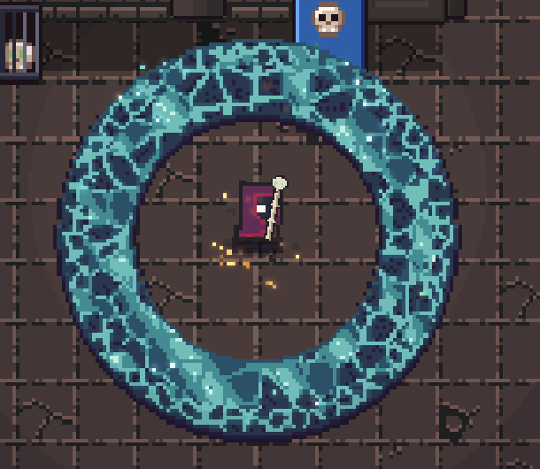
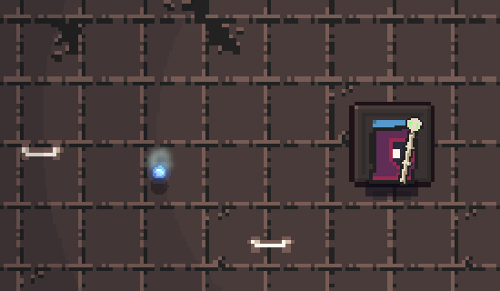

# Physikalische Seelenpixel und reagierende Oberflächen

04.11.2026 · Basis `ab181e4a` · `codex_v2` · Godot 4.7.2 Compatibility.

Aktive Seelen-VFX emittieren simulierte Pixel in den bestehenden Partikelraum.
Flüssige Materialoberflächen aller Klassen empfangen die Druckfronten dieses
Raums über die vorhandenen, skalierten WeakRef-Verbindungen. Beschworene
Wächter bleiben Figuren; ihre Staubaura ist Partikelmaterie. Details und
Einheiten: `docs/SEELEN-MATERIE.de.md`.

## Prüfungen

| Ausführung | Ergebnis |
|---|---|
| `soul_matter_physics_test.gd` | 24 / 0 Fehler |
| `particles_physics_test.gd` | 26 / 0 Fehler |
| `pool_field_test.gd` | 58 / 0 Fehler |
| `soul_absorption_test.gd` | 17 / 0 Fehler |
| `soul_ring_test.gd` | 19 / 0 Fehler |

Summe: **144 Prüfungen, 0 Fehler**. Neue Prüfungen: eigener Teilchenzustand,
genau einmalige Emission, getrennte Wind-/Sogwirkung, Druckablenkung, tatsächliche
Ankunft beim Stab, Wandkontakt auch bei 15 FPS, Abklingen und Begrenzung der
Oberfläche, Abschirmung durch Wände, Weltmaßstab, unveränderte Gameplayzellen,
30/60/144 Renderbilder/s, bereits angehobene Geschosskoordinaten und gemeinsamer
Partikeldeckel. Gegen den bisherigen Stand zuerst zwei erwartete Fehler:
fehlender physikalischer Seelenstrom und fehlender Oberflächen-Druckanschluss.

Der vorhandene Ring-Test wartete noch 0,7–0,75 s auf das Ende der Ausbreitung;
`HEAD` definiert bereits `ring_expand=1`. Fünf alte Erwartungen schlugen deshalb
zunächst fehl. Der Test folgt jetzt dieser Spieldatei; Talentdaten und
Kampflogik wurden nicht verändert. Das ist eine Testkorrektur, keine
Verkürzung der Ausbreitungszeit.

`surface_motion_bench.gd`: **651 Knoten, 3601,5 µs pro Schritt im Mittel**,
unter dem angegebenen isolierten CPU-Budget von 8000 µs. Dieser Messwert
beschreibt den neuen Oberflächenlöser, keine gesamte Spiel-Framerate.
Ruhende Flächen bauen kein verformtes Mesh auf. Die vorhandene Grenze von
900 Partikeln bleibt erhalten; Oberflächenknoten und Mesh-Unterteilungen sind
zusätzlich begrenzt.

## GPU-Aufnahmen

`scripts/capture_soul_matter.gd`: aktueller Krypta-Renderer, normal gelernter
und bezahlter Seelenring, freie Stelle einer unveränderten generierten Karte.
Nach vollständigem Ausbreiten wird die tatsächliche Kraftfunktion
`HellMonsters._blow_front` mit einer kontrollierten Front aufgerufen. Die
Aufnahme prüft diesen Anschluss; sie ist kein vollständiger Bosskampf.
Die Auslenkung erreicht den begrenzten Ausschlag und klingt anschließend ab.
Gemessen: **10,8 Weltpixel** maximal, **0,037 Weltpixel** bei Bild 250;
höchstens **101 Partikel** in dieser kontrollierten Aufnahme. Pool-Zeichenweg
im Mittel **3149,3 µs**, einschließlich des bestehenden Materialaufbaus.
Das GIF ist ein nearest-vergrößerter Ausschnitt der Rohbilder, keine
Bildgeneration. `capture_soul_absorption.gd` zeigt zusätzlich einen bestätigten
Gegner-Kill mit echter Pixelaufnahme und unveränderter Seelenleiste.

Logs enthalten die gemessene Auslenkung, Partikelzahl und die Zeit des
Pool-Zeichenwegs. Die CPU-Prüfungen sind reproduzierbare Synthese-Fixtures;
die konkrete Aufnahmekarte ist pro Run generiert. Finale Logs enthalten keine
`SCRIPT ERROR`/Parsefehler. `git diff --check` für die bearbeiteten verfolgten
Dateien ist ohne Befund.

## Grenzen

Die Verformung ist kosmetische Client-Physik. Autoritative Schadenszellen,
Kontrolle, Seelenbuchung und Netzwerkprotokoll bleiben unverändert. Kein neuer
Mehrprozess-/LAN-Test und keine Vier-Spieler-Performance-Abnahme. Die bekannten
Game-Fixtures melden beim Beenden weiterhin 6 ObjectDB-Instanzen und 2
Ressourcen; diese Meldungen bestanden bereits vor diesem Schritt. Die GPU
meldet fehlenden Zugriff auf den Shadercache unter `user://`; Aufnahmen wurden
trotzdem erzeugt. Nutzerabnahme des neuen Looks steht aus.

Frühe Aufnahme-Fixtures wurden berichtigt: auch der Boden muss beim manuellen
Steppen neu gezeichnet werden, der Partikelstrom braucht eine freie Sichtlinie
und normales Ausbreiten muss vor der Druckwelle abgeschlossen sein. Diese
Fixtures verändern keine gespeicherten Karten oder Spielerprofile. Keine
Commits oder Pushes ausgeführt.

