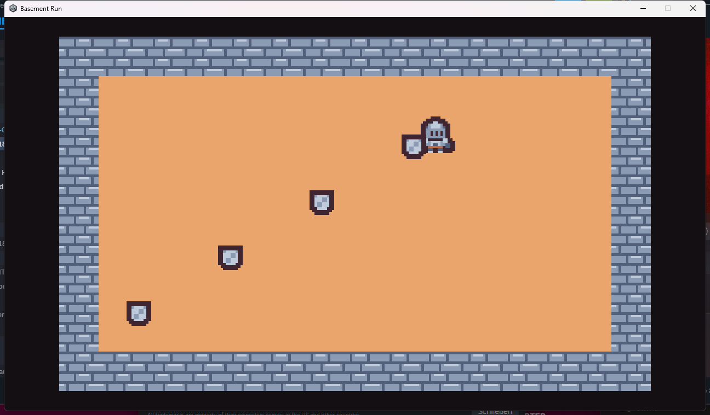

# Evidence: Story 001 — Player movement and twin-stick shooting

**Story**: `production/epics/basement-run/story-001-player-movement-shooting.md`
**Type**: Visual/Feel
**Date**: 2026-10-25
**Build**: `Builds/Win64/BasementRun.exe` (Unity 6000.3.26f1), scene `TestRoom`

## Screenshot

After 0.7 s of W+D the knight has moved diagonally up-right; the left mouse
button is held with the cursor at the lower left, and four stones fly toward it
at even spacing. Stamp: `story-001-player-movement-shooting/stamp.txt`.

## Checked by the user (hands-on, 2026-10-25)

- 8-direction movement with WASD, no diagonal speed boost: passes
- Mouse aim and fire, arrow keys fire: passes
- Projectiles despawn on wall hit: passes
- Player cannot leave the room: passes
- Movement and shooting feel responsive: passes

Not tested: right-stick aim, despawn after lifetime.

## Sign-off

| Role | Name | Verdict |
|------|------|---------|
| Lead / feel | Christopher (project owner) | [x] Approved |
