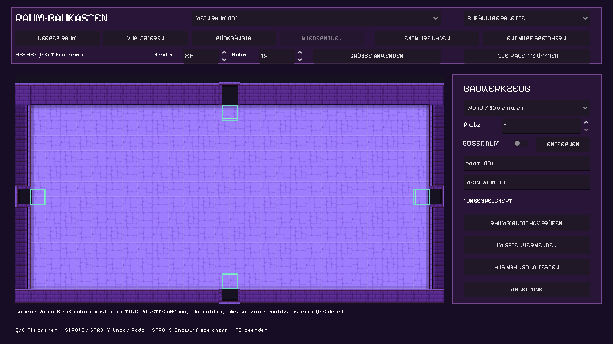
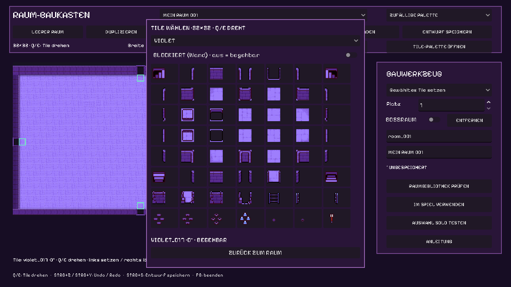
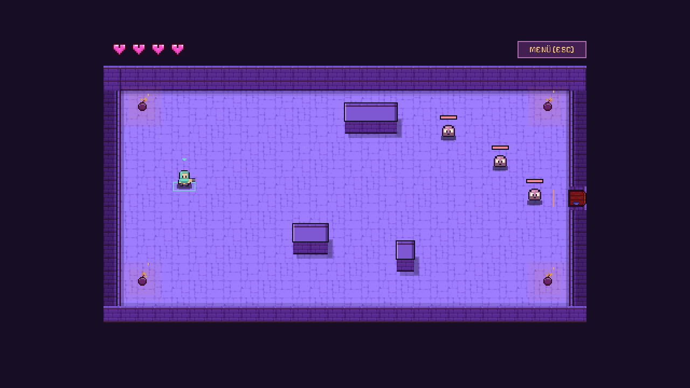
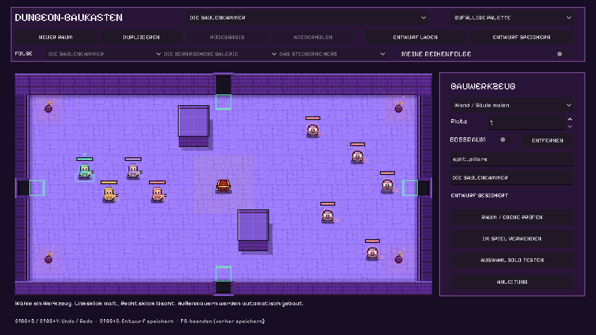
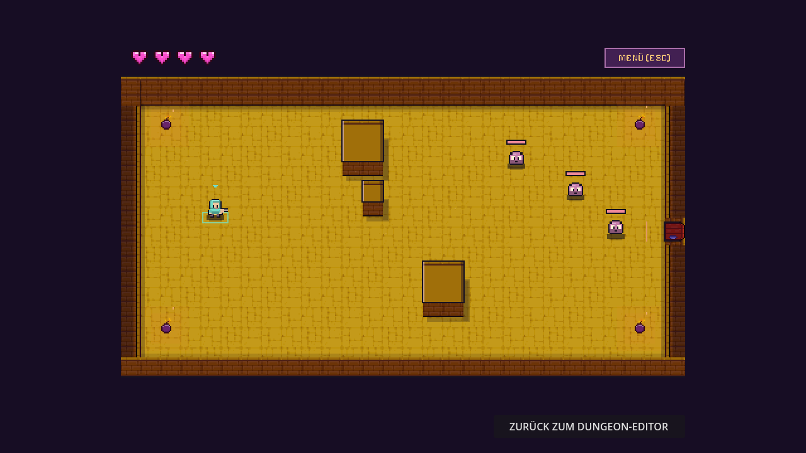

# Prüfbericht: Godot-Entwicklungsbasis

## Aktuelle32px-Chibis und Lovecraft-Boss,27.10.2026

Story024 aktiviert128 echte32×32-Schlüsselbilder und16 neue Atlanten für
acht Figuren. Native Assets691/0, Zuschnitt33/0, Bank21.597/0, Rig8/0,
Controller14/0, Studio1.965/0, Game38/0 und Kryptaintegration127/0 bestanden.
Import/Parse erfolgreich; persönlicher Entwurf SHA256-unverändert. Boss10
bleibt mit denselben Werten/Angriffen, hat jetzt Tentakel/Jadeaugen und neuen
Anzeigenamen. Kein Protokollschemawechsel, Inhaltsabgleich erfasst den Namen.

GPU zeigt sechs Beispielaktionen, Werkstatt, Kryptareferenz und Solo-Start.
Unabhängige Sichtprüfung umfasst1.152 ausgewählte Frames und hält Hand-/Stab-
Kontinuität sowie komplette Stiefel/Waffen in dieser Auswahl fest. Kein neuer
FPS-/LAN-/Vollkampagnennachweis oder Nutzer-Artfreigabe.
[Aktueller Umfang und Bilder](../../docs/CHIBI32-ELDRITCH.de.md).

## Aktuelle Figurenanimationen,27.10.2026

Story023: acht Figuren ×48 unabhängige Abläufe ×vier Richtungen ×sechs Bilder
=9.216 gebackene Frames. Vier neu generierte Spieler; alte Quellen bleiben.
35 Aktionskennungen mit rollenabhängiger Anbindung,13 vorbereitet.
Bank21.597/0, Motion14/0, Rig8/0, Game38/0, Studio1.965/0 (GPU1.966/0),
Fußanker-GPU10/0 und kontrollierte lokale Host-/Client-Replikation bestanden.
Perks100/0, Feedback19/0, AI171/0, Gegnerintegration127/0, Regeln24/0,
Erkundung85/0, Mitgliedschaft5/0 und Protokoll20/0 bleiben grün.

Unabhängige statische Kontrolle von1.152 ausgewählten Frames führte zur
Korrektur losgelöster Bosskrallen und wechselnder Nekromanten-Stabhand.
Ein realer GPU-Pixeltest reproduzierte Fußdrift wegen transparentem Padding
mit3Fehlern und besteht nach Korrektur ohne Fehler. Werkstattclip und Pause/
Einzelschritte sind korrigiert. Import/Parse erfolgreich, Entwurf unverändert.

GPU-Aufnahmen zeigen sechs Beispielaktionen, die bedienbare Werkstatt und
einen normalen Solo-Start. Die GIF-Zeiten folgen den Clipdauern auf10ms
gerundet, mit300ms Lesepause nach jeder Aktion. Dies ist eine Designvorschau,
kein vollständiger Playthrough, keine Last-/FPS-/LAN-Abnahme und keine
persönliche Artfreigabe. [Katalog und Nachweise](../../docs/ACTOR-ANIMATIONS.de.md).

## Aktuelle Krypta-Gegner und Stilgrundlage,26.10.2026

Story022: drei Untotenrollen mit36gemeinsamen Pixelanimationen sind integriert.
AI171/0, Gameintegration127/0, Assets/Feedback82/0, Schild-/Überschuss4/0,
Perks100/0, Feedback19/0, Spielregeln24/0 und Erkundung85/0 bestanden.
Kontrollierte Zwei-Prozess-Replikation ohne Scriptfehler bestanden. Der
abschließende Regelschutz hält Bossmarkierungen vor wiederverwendeten
Kind-Labels maßgeblich; die vorhandene Boss-Stun-/Angriffsprüfung wurde vorher
mit2Fehlern und danach fehlerfrei gesehen. Diese Prüfung ist kein gespielter Lauf.

Originalrenderer-GPU-Vorschau mit animierten Figuren bei3×Inspektionszoom sowie
normale F6-Stilwerkstatt angesehen. Persönlicher Dungeon SHA256-unverändert.
Keine neue vollständige Kampagnen-/LAN-/FPS-Abnahme; Nutzer bewertet die neuen
Figuren. [Stil, Rollen, Herkunft und Nachweise](../../docs/CRYPT-ENEMIES.de.md).

## Aktueller Perkausbau,26.10.2026

Story021:48Perks implementiert.667 Regel-/Katalogprüfungen,100 tatsächliche
Kampfprüfungen,159 UI-Prüfungen und bestehende Regeln24/0, Erkundung85/0,
Interpolation53/0, Protokoll20/0 bestanden. Zwei echte lokale Prozesse bestehen
die kontrollierte persönliche Belohnungs-/Inventarfixture. GPU-Prüfbilder zeigen
Karten, Icons, Inventar und simulierte Geschosse/Statusanzeigen. Das ist kein
neuer gespielter Kampagnen-/LAN-/FPS-Nachweis. Langfristige Balance offen;
weitere Online-/LAN-/Lastabnahme ist ausdrücklich zurückgestellt.
[Daten, Bilder und Grenzen](../../docs/PERKS.de.md).

Die nachfolgenden GameDev-Viererlauf-/FPS-Belege entstanden vor dem Perkausbau.

## Aktuelle GameDev-Ausführung,26.10.2026

Clientinterpolation und vorgeschalteter Versions-/Datenabgleich implementiert.
190 gezielte Logikprüfungen sowie sechs reale Aufnahmerollen bestanden. Aktuelle
volle Zehnerläufe mit Solo/zwei/vier unabhängigen Prozessen, Boss10, Rückweg ohne
zusätzliche Perks und Treppe/neue Ebene bestanden. Zwei-/Vierer-Neustart nach
wirklich verdientem Perk und natürlichem Gesamtwipe setzt Werte/Build/Encounter
zurück. Finale Vierer-Störprüfung:50ms je Richtung und konfigurierte1% UDP-Loss,
gleiche Raumdaten, echte View-Freigaben, genau ein Sound/Swap je Tür-/Treppentoken.

Echter sichtbarer Vierer-Client im1080p-Vollbild über alle zehn Räume und Boss:
143,68FPS durchschnittlich, p958,035ms, Bosskampf-p958,35ms. Maximale Einzelzeit
97,191ms einschließlich Raumwechsel und diagnostischer Aufnahme. Die kalte erste
Testbot-Navigation hatte einen vorherigen Messlauf scheitern lassen; Callback-
Profile belegten diese Testlast. Der Helfer wärmt nun nur seine private Navigation
vor dem Join vor. Grenzwerte unverändert; vorheriger Fehlreport bleibt erhalten.

Diese Prüfungen fanden auf einem PC statt. Echte Zwei-Rechner-/30Minuten-LAN-
Abnahme und subjektives Nutzerfeedback bleiben offen. Keine WAN-/universelle
Hardware-/Seed-Freigabe. [Bedingungen, Daten und Wiederholung](../../docs/GAMEDEV-UMSETZUNG.de.md).

## Lesbare Schrift und Vollbild,26.10.2026

Story018: Pixel Operator8 mit lokaler Originaldatei, CC0 und Glyphennachweis.
16/24/32px; Textüberläufe in Karten/Lobby behoben, HUD/Editorgrößen angepasst.
Tatsächliche GPU-Bilder zeigen1280×720,1600×1000,1920×1080-Vollbild und ein
breites Fenster. F11/Alt+Enter/ESC über den Eingabehandler geprüft, Fenster-
rechteck wiederhergestellt; fünf Stichproben der Raumblende vollständig schwarz.
Übersicht, Anzeige, Angebote, Lobby und Editor visuell angesehen. Gezielte
GUI-Eingabeprobe bestätigt Weltfeuer und unterdrückte Menü-/Drag-out-Schüsse.
Keine breite Unit-/Gameplay-/Netzwerkserie, kein vollständiger Lauf und kein
neuer Multiplayer-Leistungsnachweis. Import und geänderte Skripte ohne Syntaxfehler.
[Review/Bedingungen](../../docs/UI-VOLLBILD-REVIEW.de.md),
[Vollbilddaten](evidence/readable-fullscreen/display-check.json),
[UI-Eingabedaten](evidence/readable-fullscreen/pointer-guard.json).

## Ruhiger erster Stil und gezielte Ruckleranalyse,26.10.2026

Story017 ersetzt die gesättigte Pack-Zwischenfassung: Original-32px-Boden,
klare ruhige Mauern, warmes oranges Feuer. Keine Raumdekoration/Nebel/Sockel.
Aktive und Kandidatenbibliothek behalten zehn Karten und Boss ausschließlich
in Raum10. Persönlicher Entwurf: SHA256 unverändert
`b8afdce111e0005407e1ce0bcf4427276efed51cc987c65099671c82701bbf16`.

Gezielte CPU-Profile derselben Karte: `_draw` Median15,343→0,353ms,
p9517,079→0,386ms; zehn gleiche blockierte Pfade gesamt1878,081→11,223ms.
Statische Darstellung wird einmal vorbereitet, Navigation gecacht, Geometrie
lokal geteilt und pro Client/Raumrevision einmal zuverlässig gesendet.
Hostdarstellung/Kamera erhalten Positionen pro Physiktick statt nur20Hz.

Sichtbarer normaler Solo-Prototyp, Garten/Seed42026, sechs Gegner,1sAufwärmen
und6sMessung:864Frames,143,98FPS, Bildzeit Median6,945/p958,290/max9,114ms.
RX6600/Compatibility/VSync; keine Spieler-/Gegnerwerte verändert, kein
skriptgesteuerter Input. Tatsächliche Game-Callbacks p950,163ms Prozess und
1,481ms Physik. Der getrennte versteckte Aufnahmeversuch lag bei50FPS.

Echte GPU-Fotos der Räume1/8/9/10 und der Karte zeigen den neuen Stand;
für Fotos Simulation angehalten und Räume direkt geöffnet. Kein vollständiger
Durchlauf, keine breite Unit-/Spiel-/Netzwerkserie und keine Vier-Spieler-
Leistungsmessung. Geänderte Skripte ohne Syntaxfehler geladen. Manuelle
Bild-/Spielabnahme bleibt offen.
[Messwerte](evidence/classic-quiet/performance.json),
[Aufnahmebedingungen](evidence/classic-quiet/capture_details.json).

Die folgenden Abschnitte zeigen frühere Stände und deren damalige Nachweise.

## Original-Pack-Rückkehr,26.10.2026

Story016: erster Godot-Commit44c9b80/Seed-Commita71387d und gelieferte spätere
Atlanten gelesen/angesehen. Dichte Materialprojektion standardmäßig deaktiviert.
Aktive und Kandidatenbibliothek überStore gesichert und in-place umgestellt.
Nichtgrafische Daten-Invariante, Konfigurationsvalidierung und erzeugte eindeutige
Zehnerfolge bestanden. Persönlicher Quellentwurf unverändert.

OriginalProps-Palette, identische Pixelprojektion aller maskierten Living-Frames,
originale32px-Fackel (fester Halter) sowie Türen/Innenabstieg wiederverwendet.
Asset-Import und Syntax ohne SCRIPT ERROR/Parse Error. Direkte normale Raum-
Aufnahmen1/8/9/10 plus Karte: `restored-original-pack/`, keine Retusche.
Keine breite Testsuite und kein vollständig gespielter Durchlauf.
Logs: original-palette-migration, original-pack-import, original-pack-game-syntax,
original-pack-editor-syntax, original-pack-art-authoring, original-pack-prototype-capture.


## Aktiver Zehner-Prototyp und angeforderte Fotos,26.10.2026

Die aktuelle Nutzeranweisung autorisiert die normale Integration und eine reale
Bildsession. Aktive Bibliothek vor Ersetzung gesichert; gespeicherte Konfiguration
und erzeugte Folge validiert. Seed42026 ergab zehn unterschiedliche Vorlagen,
crypt_01 zuerst und crypt_10 als einziges Bosslayout an Position10.

Normaler Spielstart über Host/Start, keine Editorvorschau. Tatsächlich gestartete
Räume:1 (5normale Gegner),8/Garten (6),9/Archiv (8),10 (1Boss+2normale Begleiter).
Fünf unveränderte1280×720-GPU-Aufnahmen einschließlich10-Knoten-Karte gespeichert.
Simulation für die Fotos angehalten; Raumwechsel und Bildausschnitt direkt für
Aufnahmen gesetzt. Kein abgeschlossener Lauf, kein Multiplayer-/Performancenachweis.
Danach Sitzung beendet, temporärer Port geschlossen und normales Hauptmenü mit
zufälligem nächsten Seed/Standardport wieder geöffnet.

Log: `Logs/current-prototype-capture.log` enthält
`PROTOTYPE_PHOTOS_READY maps=10 boss_room=10 shots=5 lobby_open=true` ohne
SCRIPT ERROR/Parse Error. Bilder und Metadaten:
`production/qa/evidence/current-prototype/`. Keine breite Testserie gestartet.


## Ausgewählter Raum, Themen-Deko und einheitliche Materialien,26.10.2026

Story014 behebt den Editor-Spielstart unabhängig von kompletter Bibliothek,
Raumfolge und prozeduraler Neugenerierung. Offline-Vorschau, temporäre Starts,
Rückkehr und Neustart wurden im Quellcode unabhängig geprüft. Es wurde kein
Spielmodus gestartet. Neue LIVING-Deko erhält den vorhandenen Boden.

Asset-Aufbau:16Animationsarten/64Frames, zehn Themenpaletten und gruppierte
Dekoration. Der Garten enthält36Dekorationen in Beeten statt generischer
Grabmöbel. Neues16Material-Set remappt die224Zell-IDs aller vier Terrainpaletten
auf dem bestehenden32px-Raster; Konturen und Kollision bleiben erhalten.

Die eigentliche Animation verwendet Frame0-Körper und begrenzte Effektmasken.
Die64zusammengesetzten Frames und vier neuen Skin-Atlanten wurden durch die
Asset-Pipeline exportiert. Diese Authoring-Ausführung ist kein Gameplaytest.
Quellbilder wurden nicht überschrieben. Ein typisierter Array-Ausdruck in der
Dekorationsroutine und ein Namenskonflikt im Exporthelfer wurden dabei behoben.

Import und Syntaxprüfung ohne SCRIPT ERROR/Parse Error. Das aktualisierte
Editorfenster ist im Garten geöffnet, ohne Rasterüberlagerung; Log enthält
`CRYPT_EDITOR_READY room=crypt_06 unified_stone=ready fixed_objects=ready`.
Keine Unit-, Gameplay-, Netzwerk- oder Leistungstests. Manuelle Abnahme offen.
Logs: `living-final-import`, `living-final-game-syntax`,
`living-final-editor-syntax`, `unified-art-authoring`, `living-editor-open`.
Originalentwurf und aktive Bibliothek behalten ihre vorherigen Datei-Hashes.


## Krypta-Kandidat,26.10.2026 — keine Spieltests beauftragt

Story013: erste zwei Layoutreihen vom Nutzer abgelehnt; deren Formen und
Raumstempel sind ersetzt. Aktuell: unabhängige Kammergraphen, vollständige
8-Nachbar-Kontur, feste Wandrollen und räumliche Schatten.

Ausgeführt: Grafik-Erstellung/Zerlegung, Godot-Asset-Import und `--check-only`
für Spiel und Editor. Keine SCRIPT ERROR/Parse Error im Import-/Syntaxlog.
Keine Unit-, Spiel-, Netzwerk- oder Leistungstests. Keine visuelle Abnahme aller
Seeds. Die Benutzerbewertung der neuen Fassung steht aus. Die statischen
Entwurfsbilder sind ausdrücklich keine Gameplay-Nachweise.

Logs: `Logs/crypt-asset-import.log`, `Logs/crypt-source-syntax.log`,
`Logs/crypt-editor-syntax.log`. Originalentwurf unverändert:
SHA256 `b8afdce111e0005407e1ce0bcf4427276efed51cc987c65099671c82701bbf16`.


## Ganze Flächen bearbeiten,26.10.2026

Story011 ergänzt Rechteckauswahl, Strg+A, Auswahl-Ersetzen/Löschen und atomisches
Undo/Redo. Palettewechsel bewahrt den gewählten Bereich. Auswahl allein verändert
keine Raumdaten; Dialoge/Textfelder schützen die Tastaturaktionen.

| Prüfung | Ergebnis |
| --- | --- |
| Batch-Modell | `EDITOR_AREA24/0`: zwei Ebenen, Door/Stair, geschützte Props, andere Räume/Nachbarn, Clipping,32-Bit-Endüberlauf, ungültige IDs, No-op-Historie, Legacy-Säulen und maximal3072Zellen/6144Tiles |
| Echte UI-Eingaben | `EDITOR_AREA_UI20/0`: inklusive Rückwärts-Drag bei0,5×Zoom, Palette, Buttons, ganze Fläche, Text-/Dialogguards, Release über UI, Rechtsklick, Esc und Raumwechsel |
| Regressionen | Replacement29/0, Rasterklassifikation17/0, freies Modell13/0, freie UI20/0, frühere UI20/0, Editorintegration32/0 |
| Sichtprüfung | OpenGL-Auswahl,24-Feld-Ersetzen,24-Feld-Löschen und Undo gerendert und angesehen; Buttons/Status ohne Überlagerung |

Beide neuenSuitenwurdenvorImplementierungrot1/1beobachtet. Logs:
`Logs/editor-area-red.log`, `Logs/editor-area-green.log`,
`Logs/area-final-*.log`, `Logs/editor-area-visual.log`.
Die Aufnahmen verwenden ausschließlich eine in-memoryFixture, keinen Nutzerentwurf.


## Tile-Ersetzen und sichtbare Kollisionen,26.10.2026

Story010: Ersatzgrafiken greifen auf derselben Zelle, einschließlich neuer
Rotation/Kollision und Q/E während eines gehaltenen Pinselstrichs. ERSETZEN
ist standardmäßig aktiv; ausgeschaltet bleiben die Ebenen unabhängig.

| Prüfung | Ergebnis |
| --- | --- |
| Replacement | `EDITOR_TILE_REPLACEMENT29/0`: echte Mausereignisse, neue Pinselgeste auf derselben Zelle, Q/E im Drag, Ebenenmodus, Türen/Treppen, geschützte Spawn-/Propdaten, Legacy-Säule und atomisches Undo/Redo |
| Kollisionsklassifikation | `EDITOR_COLLISION_GRID17/0`: tatsächlicher Boden/Wand/Void, Non-solid-Deko, Tür ohne Boden, Legacy-Ränder, Rotation, Daten unverändert |
| Gerenderte Rasterfarben | `EDITOR_GRID_RENDER6/0` unter OpenGL: grüne Bodenmarkierung, rote Wand, grauer Void, Legende und vollständiges Ausblenden über die Raster-Checkbox |
| Bestehende Suiten | Freies Modell13/0, freie UI20/0, freie Geometrie30/0, frühere UI20/0, Editorintegration32/0, Autorenmodell27/0, Dungeonintegration23/0 |

Repros vor Fix rot13/4 (gleiche Zelle/aktiver Drag) und29/2 (Legacy-Säulenzelle).
Klassifikationshelfer vor Implementierung rot1/1. Quellen:
`Logs/editor-tile-replacement-red.log`, `editor-tile-legacy-replacement-red.log`,
`editor-repair-*.log`, `editor-grid-render.log`. Raster-An/Aus und Palette grafisch
angesehen. Keine Gameplay-/Netzwerkdaten durch die Rasteransicht verändert.


## Freie Zeichenfläche und selbst gemalte Raumkonturen,26.10.2026

Story009: Neue Räume haben keinerlei automatischen Boden, Randmauer, Eingang
oder Spawn. Unbemalte Flächen bleiben leer und blockieren im Hostlayout.

| Prüfung | Ergebnis |
| --- | --- |
| Autorenmodell | `FREEFORM_MODEL13/0`: echte Leere, alle Randzellen nutzbar, getrennte Ebenen, Tür schneidet Wand ohne Boden zu erfinden, explizite Starts, Resize/Undo |
| Geometrie/Dateien | `FREEFORM_GEOMETRY30/0`: vorhandene kompatible Ports, Void-Kollision, Floorinseln, gleiche Seedfolge, sichere primitive Typen/Koordinaten, explizite Stufengrafik, unfertige Drafts und2MB-Schreibgrenze |
| Editor/Spiel | `FREEFORM_EDITOR_UI20/0`: Hell/Dunkel/Raster, beide Ebenen, echte Innenraumtür mitQ/E, Startplätze, Dateirundlauf und kompatible Auswahl-Testfolge |
| Gerenderte Pixel | `FREEFORM_RENDER4/0` in Compatibility/OpenGL: vollständig weiße Leere inklusive aller Ränder, nur gewählte Zellen ändern sich, keine automatische Türverlagerung, schwarzer Grund |
| Bestehende Regeln | Generator4146/0, Ports1585/0, Spiel22/0, Erkundung52/0, Dungeon23/0, Session19/0, Pause25/0, Karten20/0, Kamera4/0 |
| Aktualisierte Autorentests | Modell18/0, UI20/0, Autor27/0; freie Räume werden in Fixtures ausdrücklich vollständig bemalt und mit Starts/Türen versehen |
| Reale Übertragung | `custom_room_network_smoke.ps1 -Freeform`: zwei ENet-Prozesse,799 Tiles,1280×768, Void und Wandkollision sowie frei gesetzte Tür bei[1216,352,32,32] identisch empfangen |

Logquellen: `Logs/freeform-final-*.log`, `Logs/freeform-render-green.log`,
`Logs/custom-room-network/20261026-113731`. Der Netzwerkfall ist eine kontrollierte
Transport-Fixture, kein Kampf-/Leistungsnachweis. Reale OpenGL-Bilder der weißen
und schwarzen Leere, einer manuell gemaltenL-Form und der Ebenenpalette angesehen.

Neue Verhaltenstests wurden zunächst rot beobachtet. Zusätzlich rot nachgewiesen
und korrigiert: überlaufende Zellkoordinaten, kleine isolierte Bodeninsel,
ungeeignete feste Testfolge und zu große, nicht wieder einlesbare Draftdatei.
Die Renderprüfung scheiterte mit4/4 bei vorübergehend deaktiviertem freiem
Rendererzweig und besteht mit4/0 beim endgültigen Code.


## Aktuelle32-Pixel- und Editorprüfung,26.10.2026

Branch `codex_v2`, lokale Änderungen. Die datierten Abschnitte darunter sind
historische Nachweise ihrer jeweiligen Version. Aktueller Editor:
[Bedienung](../../docs/DUNGEON-EDITOR.de.md). Kamera/Blenden:
[Anleitung](../../docs/ANIMATIONEN-UEBERGAENGE.de.md).

| Prüfung | Ergebnis |
| --- | --- |
| Freie Maße/Dateien | `FREE_ROOM checked=14 failures=0`: leer, individuell groß, Undo/Redo, Kollision jenseits alter Raumgrenze, sichere Verkleinerung und Dateirundlauf |
| Reale Editor-/Spielanbindung | `FREE_ROOM_UI checked=15 failures=0`: Breite/Höhe, Canvaszoom, Q/E-Ereignisse, skalierte Mausplatzierung, Ghost-Ausrichtung, Rotation/Kollision im JSON, isolierter Test und Rückkehr |
| Kamera | `ROOM_CAMERA checked=4 failures=0`: sanftes Folgen, ganzzahlige Verschiebung, Pause und Raumgrenzen |
| Bestehende Geometrie | Generator4146/0, Ports1585/0, Autorenmodell25/0, Editorintegration32/0, Dungeonintegration23/0 |
| Bestehendes Spiel/UI | Erkundung52/0, Sessionpresentation19/0, Pause25/0, Karten20/0 |
| Vorheriger Animations-/Fade-Ausbau | Animation25/0, Feedback19/0, Transition29/0, Spiel22/0; Vierer-Kampf über zwei Ebenen bestand im32-Pixel-Stand |
| Individueller Raum über ENet | Zwei echte Prozesse:798 Tiles,1280×768, gedrehte Zelle und Hostkollision identisch auf Client. Synthetische Transport-Fixture, kein Kampf-/Performancetest |
| Sichtprüfung | OpenGL-Aufnahmen: blanker Raum, große Vorlage, Palette, Kamera vor/nach Bewegung angesehen. Originalgrafiken unverändert;280 extrahierte PNGs je32×32 |

Der neue Modelltest wurde vor Implementierung rot gesehen, ebenso die fehlende
Kamera. Eine falsch transformierte Ghost-Vorschau wurde durch eine zusätzliche
rote Prüfung und gemeinsame Platzierungstransformation korrigiert.

Aktuelle Logquellen: `Logs/free-room-*.log`,
`Logs/custom-room-network/20261026-080624`. Frühere aktuelle32-Pixel-Nachweise:
`Logs/dungeon-network-smoke/20261026-011814-50622b16` (vier Prozesse/zwei Ebenen),
`Logs/transition-network-smoke/20261026-012523-f9ad7cca` (zwei Prozesse/fünf
vollständig schwarz gedeckte Wechsel und fünf genau einmal ausgelöste Sounds).
Nach der Kameraanbindung erneut bestanden:
`Logs/transition-network-smoke/20261026-110204-d4046c72` mit denselben fünf
Wechseln über zwei Ebenen auf beiden realen Netzwerkseiten.

Die Grafik-/Kameraaufnahmen verwenden kontrollierte Fixtures. Der normale
Vierer-Kampf und die Fade-Bots verwenden gewöhnliche Spieleingaben. Keine neue
LAN-/WAN-, Paketverlust-, Latenz- oder Leistungsabnahme.






Stand: 24.10.2026. Branch: `codex/development-environment-plan`.
Aktuelles Limit: **vier Gesamtspieler**, also Host plus drei Clients.
Godot: `4.7.2.stable.official.ed1daf0bf`, Windows, Compatibility Renderer.

## Belohnungskarten und Pixel-Schrift vom 25.10.2026

Story006 ersetzt die vom Nutzer abgelehnte Listenansicht durch eigenständige
halbtransparente Karten. Neue UI-Schrift: lokal gebündelte Pixelify Sans.
Anleitung/Quellen: [Belohnungen](../../docs/BELOHNUNGEN.de.md).

| Prüfung | Tatsächliches Ergebnis |
| --- | --- |
| Kartenintegration | `REWARD_CARDS checked=20 failures=0`: getrennte Sichtbarkeit, Transparenz, große anklickbare Symbole, Pixelfont, Pfeil/Enter, echte Perk-ID, Doppelklickschutz, bestätigte Markierung, verzögerte Ack/Ready, Fokus und Rückkehr |
| Menüregression | `PAUSE_MENU checked=25 failures=0`, auf separate Kartenansicht angepasst |
| Bestehende Suiten | Spielregeln22/0, Erkundung51/0, Dungeon-Integration23/0, Editor-Integration25/0 |
| Import/Parse | `Dev.ps1 Check`:16 Spielskripte erfolgreich geladen |
| Reale Kartenauswahl | Host und Client gewinnen normalen Kampf, wählen unterschiedliche Karten, erhalten korrekte persönliche Perks, bestätigen Ready und bleiben in Raum1 zur Erkundung; beide Exit0 |
| Reale Menüregression | Welt, Snapshots und neutrale lokale Eingaben laufen während persönlicher Mehrspieler-Menüs weiter; beide Exit0 |
| Grafik/Schrift | Fünf16×16-RGBA-Icons mit binärer Alpha und höchstens24 Farben; Originale/Prompts vorhanden. Deutsche Fontglyphen und proportionale Breiten geprüft. Karten vor/nach Auswahl, Menü, Artreferenz und Baukasten grafisch geprüft |

Kartenprüfung vor Umsetzung rot1/1. Unabhängiger Reviewer prüfte Modalzustände,
Eingaben, ausstehende Bestätigungen und Lebenszyklus ohne materielle Findings
und führte zusätzlich20/0 sowie25/0 aus.

Prozessläufe:

- `Logs/reward-network-smoke/20261025-233204-a5c5ec33`: Host wählt `shadow`, Client
  `heart`; beide `acknowledged=true explored=true result=PASS`.
- `Logs/reward-network-smoke/20261025-233152-c1ca2d18`: zusätzlicher unabhängiger Lauf.
- `Logs/pause-network-smoke/20261025-233204-b7603be1`: bestehender Menüfall PASS.

Die UI-Aufnahmen verwenden einen ausdrücklich als Fixture erzeugten Clear-Zustand.
Der Prozess-Smoke verändert weder Schaden noch Gegner oder Perks künstlich.
Die gelieferten Atlanten bleiben unverändert; neue Symbole liegen separat.
Keine neue LAN-/WAN-/Leistungsabnahme. Historische Abschnitte bleiben nachvollziehbar.


## Esc-Menü und reduziertes Live-HUD vom 25.10.2026

Branch `codex_v2`, lokale Änderungen. Herzen bleiben oben links; weitere Daten
stehen im Menü. [Bedienung und Bilder](../../docs/SPIELMENUE.de.md).

| Prüfung | Ergebnis und Aussage |
| --- | --- |
| Menü-/Simulationsintegration | `PAUSE_MENU checked=25 failures=0`: Esc/Repeat/Fokus, versteckte Infos, Herzbild nach Schaden, Solo-Stopp bei aktivem Transport, Menüabschnitte, Perk/Ready, andere Spieler bewegen sich weiter, Neustart und Verlassen |
| Bestehende Suiten | Spielregeln22/0, Erkundung51/0, Dungeon-Integration23/0, Editor-Integration25/0 |
| Import/Parse | `Dev.ps1 Check`:14 Spielskripte erfolgreich geladen |
| Zwei echte Prozesse mit Menü | Host und Client öffnen jeweils ihr Menü; Gegnerzustände und Snapshots schreiten weiter. Host erhält neutrale Clientbefehle; beide Exit0 |
| Vier echte Prozesse | Zwei Ebenen, sechs gleiche Layouts/Hashes,24 persönliche Perks und freie Erkundung; alle Exit0 |
| Sichtprüfung | OpenGL-Hauptansicht, Übersicht, Karte, Gruppe, Belohnung, Steuerung und Sitzung angesehen; Editor-Rückkehrbutton unter der Spielwelt geprüft |

TDD: neue Funktion vor Implementierung rot1/1. Der zusätzliche Fehlerfall
„Belohnungsseite schließt sich während Erkundung“ wurde rot23/1 beobachtet,
anschließend behoben und die Suite auf25/0 erweitert.

Prozessnachweise:

- `Logs/pause-network-smoke/20261025-224126-f979bb47`: zwei reale ENet-Prozesse,
  `PAUSE_PEER ... result=PASS` auf beiden Seiten; Host `neutral_remote=true`.
- `Logs/dungeon-network-smoke/20261025-223618-d53490ff`: Vierer-Lauf76,7s.

Die Menüaufnahmen verwenden die tatsächlichen Spiel-/UI-Klassen in einer
angehaltenen Aufnahmesitzung; für die Belohnungsansicht wurde der vorhandene
Clear-Pfad als Fixture ausgelöst. Der separate Vierer-Prozess-Smoke gewinnt
seine Kämpfe weiterhin ausschließlich durch normale Bot-Eingaben.
Keine globale Mehrspieler-Pause implementiert. LAN/WAN, Latenz/Paketverlust
und Leistung bleiben offen. Historische UI-Aufnahmen unten zeigen frühere Stände.




## Dungeon-Baukasten vom 25.10.2026

Branch `codex_v2`; noch lokale Änderungen. Anleitung:
[Eigene Dungeons bauen](../../docs/DUNGEON-EDITOR.de.md).

| Prüfung | Ergebnis und Grenze |
| --- | --- |
| Autorenzustand | `DUNGEON_AUTHORING checked=18 failures=0`: zusammenhängende Wandrechtecke, Undo/Redo, Raumverwaltung, portable Daten und gewählte Reihenfolge |
| Datei-/UI-/Spielintegration | `DUNGEON_EDITOR_INTEGRATION checked=25 failures=0`: echte temporäre Dateien, Sicherung, Save/Load, ungültiges JSON, abgewiesene Übernahme, Schutz der aktiven Datei, Pinselstrich/Release, Nordtür, Thema, gemalte Hostkollision, Truhe/Feuer/Bosstreppe, Loopback-Solotest und Rückkehr |
| Bestehende Suiten unter Generator3 | Generator4146/0, Ports1585/0, Spielregeln22/0, Dungeon-Integration23/0, Erkundung51/0 |
| Import/Parse | `Dev.ps1 Check` erfolgreich:13 Spielskripte geladen |
| Windows-Starter | `Dev.ps1 DungeonEditor` mit Windows PowerShell5.1 ausgeführt; eigene Godot-Instanz mit der Baukasten-Szene und sichtbarem Hauptfenster gestartet |
| Vier unabhängige Prozesse | PASS: zwei Ebenen, sechs gleiche Layouts samt Version3/SHA256,24 persönliche Perks und freie Erkundung; alle Prozesse Exit0 |
| Sichtprüfung | Echte OpenGL-Aufnahmen der Oberfläche und eines Solo-Testlaufs mit gemalter Wand und fester Amber-Palette angesehen; kein Ersatzrenderer |

Der Modelltest wurde vor Implementierung rot gesehen. Zwei zusätzliche Fehler
wurden mit zunächst fehlschlagenden Regressionen abgesichert: Türwerkzeug in
der angeschnittenen Nordzeile (18/1→18/0) und Save As auf die aktive Spieldatei
(23/1→23/0, danach um Ausstattung erweitert auf25/0).
Die Integration verwendet ausschließlich disposable `user://`-Dateien und prüft
zusätzlich, dass die tatsächliche Projektkonfiguration unverändert bleibt.

Vierer-Lauf: `Logs/dungeon-network-smoke/20261025-204655-4300ddc6`,76,2s.
Im vorausgehenden Lauf `20261025-204251-4e446748` beendete der Host die Sitzung
vor dem zuletzt gestarteten Client; die sechs Räume waren bereits abgeschlossen.
Dieser Testzeitfehler wurde durch Berechnung der Clientlaufzeit aus der
tatsächlich verstrichenen Startzeit behoben und der ganze Lauf wiederholt.
LAN/WAN, künstliche Latenz/Paketverlust und Leistungsgrenzen bleiben offen.





## Artstyle-Werkstatt vom 25.10.2026

Neue feste Szene `src/art_reference.tscn` mit wiederverwendeter Spielgrafik und
vier getrennten Ansichten. Quellen/Designableitung: `docs/ART-DIRECTION.de.md`.
Die Werkstatt ist eine Designvorschau und kein Kampfnachweis.

- Zehn Spielskripte erfolgreich importiert und geladen (`Dev.ps1 Check`).
- Referenzszene mit `--headless --editor` geöffnet: Exit0, keine Scriptfehler.
- Vier echte OpenGL-Aufnahmen: Gesamtbild, Raum, Figuren/Effekte und HUD;
  alle angesehen. Ganze, halbe und leere Herzen zusätzlich als Grafik geprüft.
- Profiländerung aktualisiert die Darstellung bei unveränderten Hindernis-
  Rechtecken. Die Szene bleibt bei OfflineMultiplayerPeer; kein ENet-Start.
- Capture: `ART_REFERENCE layers=4 single_health_image=true profile_refresh=true geometry_unchanged=true`, Exit0.
- Bestehende `GAME_RULES checked=22 failures=0` und
  `EXPLORATION_RULES checked=51 failures=0` erneut bestanden.
- Hauptspiel mit neuem Herzbild erfolgreich gestartet und angesehen:
  `evidence/art-reference-game-regression.png`. Netzwerk-/Spielregeln wurden
  durch diesen Grafikschritt nicht als neu abgenommen ausgegeben.

Bilder: [Gesamtbild](evidence/art-reference-overview.png),
[Raum](evidence/art-reference-room.png), [Figuren](evidence/art-reference-actors.png),
[HUD](evidence/art-reference-hud.png), [Herzzustände](evidence/health-strip-states.png).

## Native16, Erkundung und Trefferfeedback

Ausbau vom 25.10.2026 auf Branch `codex_v2`. Die frühere 32×32-Darstellung und
der automatische Ready→Raumwechsel sind durch die neuesten Nutzeranforderungen
ersetzt. Raster, Basissprites und Geometrie sind nativ 16 Pixel; UI und Spielwelt
werden passend zur Anzeige ganzzahlig gezeichnet.

| Prüfung | Ergebnis und Grenze |
| --- | --- |
| Generator | `DUNGEON_GENERATOR checked=4146 failures=0` — Seed, Konnektivität und gemeinsame Geometrie |
| Türen/Treppen | `DUNGEON_PORTS checked=1585 failures=0` — alle Seiten, Gegenports, vier freie Ankunftsplätze, blockierte Konfiguration und 10-Raum-Maximum |
| Bestehende Spielregeln | `GAME_RULES checked=22 failures=0` — angepasst auf Ready→Erkundung und physische Ausgänge |
| Einbindung | `DUNGEON_INTEGRATION checked=23 failures=0` — native Maße, Spawns, Säulen, Schüsse, echte Clear-IDs und Neustart |
| Erkundung/Feedback | `EXPLORATION_RULES checked=51 failures=0` — Bewegung nach Clear, Rückwege ohne Farming, LP/Stun/Flash/Knockback, Boss-Cooldown, vierköpfige Türgruppe, Abstieg mit Build-Erhalt |
| Zwei echte Prozesse | Zwei Ebenen, sechs gleiche Layout-IDs/Vorlagen/Version2/SHA256, zwölf persönliche Perks, Türen und Treppe, abschließend freie Erkundung, beide Exit0 |
| Vier echte Prozesse | Host plus drei Clients, dieselben sechs Layouts, 24 persönliche Perks, beide Bosse, gemeinsamer Abstieg, vier saubere Exitcodes und drei Abmeldungen |
| Godot-Import/Parse | Sieben Spielskripte importiert und geladen, `Dev.ps1 Check` erfolgreich |
| Assets | Acht neu gezeichnete16×16-PNG-Sprites; vier112×128-Atlanten, UI112×144, Items128×112 und Animation128×96 unverändert übernommen |

Tatsächliche Prozessläufe (75,7 s):

- `Logs/dungeon-network-smoke/20261025-151905-76551b5e` — zwei Teilnehmer.
- `Logs/dungeon-network-smoke/20261025-152111-cad20842` — vier Teilnehmer.

Alle Kämpfe wurden mit gewöhnlichen Bot-Eingaben gewonnen; kein künstliches
Gegnerlöschen im Prozess-Smoke. Keine Godot-Fehler in diesen Läufen. Neue
Erkundungsprüfung vor Implementierung rot beobachtet (6/3); Porttest vor
Umsetzung mit25Fehlern, migrierter16-Pixel-Porttest vor Radiusanpassung mit14.
Die Debug-/Fixtureaufnahmen unter `work/` zählen nicht als Hauptspielnachweis.

Die grafische Abnahme zeigt hohe Wandflächen, echte Ecken ohne fälschliche
Treppenregionen, erhöhte Säulen mit Vorderflächen/Schatten und Tiefensortierung
mit Figuren. Nach Nutzerkritik wurde der erste flache Rahmen ersetzt; die
vermeintlichen Eckregionen `(0,0)` und `(96,0)` waren tatsächlich Treppen.
Diese werden nicht mehr als Mauer verwendet. Die getrennte Innentreppe nutzt
gezielt das Abwärtsstufenmotiv. Aufnahmen aus dem echten Hauptspiel:
[Kampf](evidence/godot-native16-combat.png),
[freie Erkundung nach dem Boss](evidence/godot-native16-explore.png).

Dieser Nachweis gilt für lokale Funktion über Loopback. LAN/WAN, künstliche
Latenz/Paketverlust, Dauerlast und FPS-/Bandbreitenmessung bleiben offen.
Die gezeichneten Truhen/Perkangebote sind die Darstellung der vorhandenen
persönlichen Auswahl, keine zusätzliche Pickup-/Inventarmechanik.

## Ergänzung vom 25.10.2026 vor V2-Push

Der Vierer-Smoke fand einen sporadischen nativen ENet-Fehler bei gleichzeitigem
Verbindungsabbau (`channel 0, max channels: 0`). Godots Client-Relay verschickt
intern Teilnehmermeldungen, bevor der GDScript-Abmelde-Callback läuft. Dieses
Spiel benötigt ausschließlich Host/Client-RPCs und Host-Snapshots; das Relay ist
deshalb jetzt vor jeder Verbindung deaktiviert. Die bestehende Prüfung aktiver
Transportverbindungen bleibt erhalten.

Die ursprüngliche Fehlermeldung wurde beobachtet; weitere Läufe des alten Codes
bestanden ebenfalls. Es handelt sich daher nicht um eine deterministische
Vorher/Nachher-Reproduktion oder einen Nachweis gegen jede mögliche Netzwerkrace.
Die gezielten Prüfungen des korrigierten Stands bestehen ohne Godot-Fehler:

- 21 Spielregelprüfungen, keine Fehler.
- Vier Teilnehmer, gleichzeitiges Trennen: alle drei Abmeldungen und Host allein.
- Vier Teilnehmer, umgekehrt gestaffeltes Trennen: dieselben erwarteten Endzustände.
- Zwei Teilnehmer mit skriptgesteuertem Kampfbeginn und Fortschritt.

Prüfläufe: `20261025-084000-932cc6aa`, `20261025-084000-b6a71f1d` und
`20261025-084000-5219fb92` unter lokalem `Logs/network-smoke/`.
[Godot-Quellstelle](https://github.com/godotengine/godot/blob/4.7.2-stable/modules/multiplayer/scene_multiplayer.cpp#L373-L400).
Dieser erste Stand wurde auf `codex/v2` im V2-Fork veröffentlicht. Das aktuelle
Ziel auf späteren Nutzerwunsch ist `codex_v2` im Repository des Bruders;
siehe [Veröffentlichungsnotizen](../../docs/V2-PUBLISH.de.md).

## Raumgenerator vom 25.10.2026

Geprüft mit Godot `4.7.2.stable.official.ed1daf0bf`, Compatibility, Windows.

| Prüfung | Ergebnis |
| --- | --- |
| Daten, Seed, IDs, Konnektivität, Spawns, Körper- und Projektilgeometrie, Wegsuche | `DUNGEON_GENERATOR checked=4146 failures=0` |
| Einbindung in Spawns, Bewegung, beide Projektilarten, Raumwechsel, Karte und Neustart | `DUNGEON_INTEGRATION checked=22 failures=0` |
| Bestehende Spielregeln | `GAME_RULES checked=21 failures=0` |
| Import/Parse | `Dev.ps1 Check` erfolgreich, alle vier Spielskripte geladen |
| Codex-Studio | `Studio.ps1 Check`: 25 bestanden, ein Windows-Symlinktest übersprungen; Commit-Validator erfolgreich |
| Zwei unabhängige Prozesse | `dungeon_network_smoke.ps1`: Seed 24680, alle drei Räume mit gleichen IDs, Vorlagen, Version 1 und SHA256; sechs Perks, Boss und Sieg auf beiden Seiten; beide Exit 0 |
| Vier unabhängige Prozesse | `network_smoke.ps1 -Players 4`: Host plus drei Clients in Lobby, alle Snapshots erhalten, gleichzeitiger Abbau sauber |
| Sichtprüfung | Echte Hauptspielaufnahme mit Säulen, Raumkarte, 32×32-Spieler/Gegnern und freiem HUD; Ergebnis unten |

Zwei-Prozess-Lauf: `Logs/dungeon-network-smoke/20261025-143347-eb805108`.
Vierer-Lobby: `Logs/network-smoke/20261025-143347-c644ff3e`.
Diese ignorierten lokalen Logs gehören nicht zum Commit; der Test ist wiederholbar.
Keine `SCRIPT ERROR`-/Godot-Fehler in den Prozessprüfungen. Der Generator-Test
wurde vor Implementierung rot gesehen; die neue Integrationsprüfung scheiterte
am alten Spielstand mit zwei Fehlern und besteht nach der Integration.


Der Nachweis gilt für lokale Funktionen über Loopback. Vier-Spieler-Kampf,
reales LAN/WAN, künstliche Latenz/Paketverlust, Bandbreite und Dauerleistung
sind weiterhin nicht durch diese Tests belegt. Die Route ist linear und wird
gemeinsam über das bestehende Ready-Gate durchlaufen; keine freie Türerkundung.

## Ursprüngliche Prüfung vom 24.10.2026

| Prüfung | Ergebnis | Grenze der Aussage |
| --- | --- | --- |
| Engine und Wrapper | Version und SHA256 des offiziellen ZIP-Downloads geprüft; `Doctor` erfolgreich | Keine Export-Templates installiert |
| Import und Skripte | `Dev.ps1 Check`: beide Spielskripte laden ohne Fehler | Keine Spielablaufprüfung durch diesen Befehl |
| Spielregeln | `GAME_RULES checked=21 failures=0`, Exitcode 0 | Direkte Zustandsprüfungen mit Godot, keine Ersatz-Clients |
| Zwei getrennte Prozesse | Drei Räume einschließlich Boss, sechs persönliche Perks, gemeinsamer Sieg auf beiden Seiten; beide Exit 0, stderr leer | Lokaler automatisierter Lauf |
| Vier getrennte Prozesse | Host + drei Clients, Snapshots auf allen Clients, fehlerfreies gleichzeitiges Trennen | Lobby und Netzwerk-Lebenszyklus; keine Vier-Spieler-Leistungsmessung |
| Fünfter Teilnehmer | Zehn Sekunden lang nicht aufgenommen, kein Snapshot, Gruppe blieb bei vier | Keine ausdrückliche Ablehnungsmeldung in diesem Zeitfenster |
| Pixelgrafik | Acht PNG-Dateien, jede anhand des PNG-Headers als 32×32 Pixel geprüft | Basisgrafik, noch keine ausgearbeiteten Animationssätze |
| Sichtprüfung | Aktuelle Kampfszene und Vierer-Lobby gerendert und geprüft | Kein ausführlicher manueller Playtest |

Die Regelprüfungen umfassen Host-Startberechtigung, unbekannte Absender,
ungültige und veraltete Eingaben, Bewegungsgrenzen, einmalige persönliche Perks,
gemeinsame Bereitschaft, Wiederbelebung, Unverwundbarkeit, Teamwipe und
Bossbelohnung vor dem Sieg. Der Host entscheidet über kritischen Spielzustand.

## Wiederholen

Aus dem Repositoryverzeichnis in PowerShell:

```powershell
./scripts/Dev.ps1 Doctor
./scripts/Dev.ps1 Check
$godot = '../tools/godot-4.7.2/Godot_v4.7.2-stable_win64_console.exe'
& $godot --headless --path . --script res://tests/game_rules.gd
./tests/network_smoke.ps1 -Players 2
./tests/network_smoke.ps1 -Players 4
```

Der wiederholbare Zwei-Spieler-Smoke prüft Verbindung und Kampfbeginn innerhalb
eines kurzen Zeitfensters. Der vollständige Zwei-Spieler-Lauf bis zum gemeinsamen
Sieg wurde zusätzlich mit den skriptgesteuerten Spielrollen durchgeführt; er wird
vom kurzen Smoke nicht als garantierte Abschlussbedingung behauptet.
Die Prozessprotokolle liegen lokal unter `Logs/network-smoke/`.
Der bestandene Vierertest liegt im Lauf `20261024-164504-ed42fc8c`.

## Bildbelege


## Nächste Prüfungen und Ausbau

- Vollständiger Vier-Spieler-Lauf mit menschlichen Spielern, Lesbarkeit und Balance.
- Latenz, Paketverlust, Interpolation und Bandbreitenmessung; Protokollversionierung.
- Zwei reale LAN-Rechner und anschließend Internet-Verbindung.
- Weitere Raumvorlagen sowie Pixel-Art-Polishing mit Idle-Animationen für Feuer,
  Figuren und Umgebung. Die Basis-PNGs und ihr Generator bleiben auf 32×32.
- Passende Export-Templates und Windows-Export; derzeit startet das Projekt mit
  der portablen Godot-Engine.

Die ursprünglichen 568 Markdown-Dateien wurden vollständig inventarisiert und
nach Projektaussagen durchsucht; maßgebliche Design- und Technikdokumente wurden
vertieft gelesen. Diese Prüfung ist keine vollständige semantische Lektüre jeder
generischen Studio-Vorlage. Details stehen in der Projektbestandsaufnahme.
`main` und das GitHub-Repository wurden nicht verändert; die Arbeit liegt lokal
auf dem eigenen Branch und wurde nicht automatisch gemergt oder veröffentlicht.
