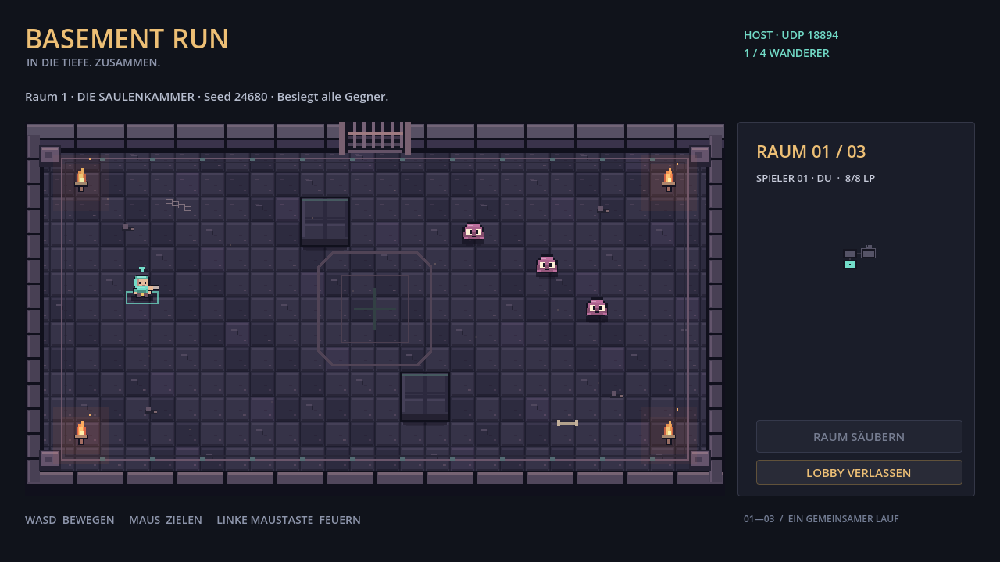
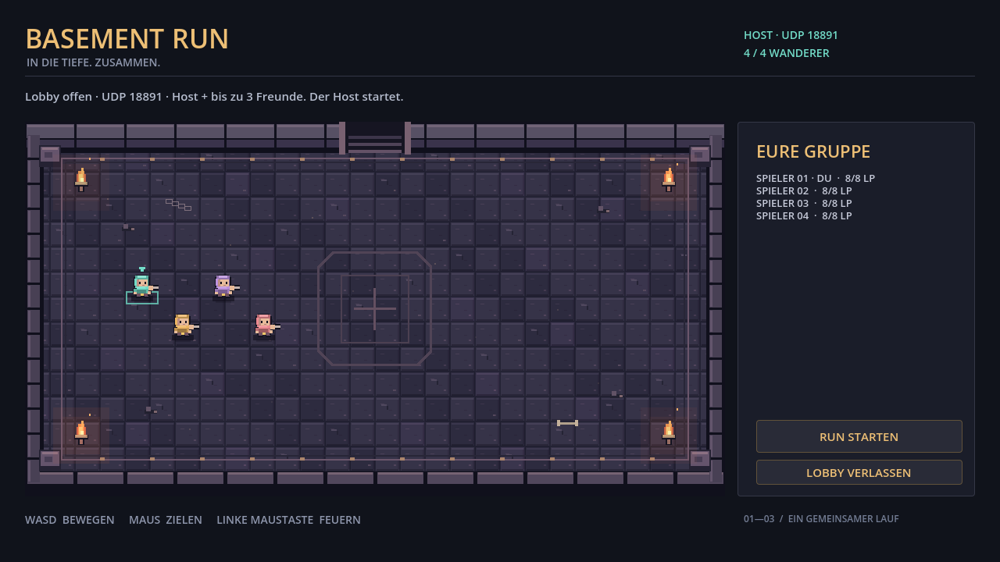
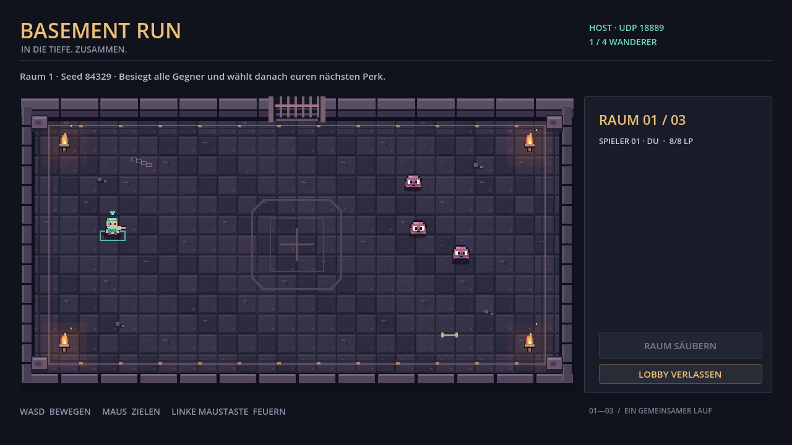

# Prüfbericht: Godot-Entwicklungsbasis

Stand: 24.10.2026. Branch: `codex/development-environment-plan`.
Aktuelles Limit: **vier Gesamtspieler**, also Host plus drei Clients.
Godot: `4.7.2.stable.official.ed1daf0bf`, Windows, Compatibility Renderer.

## Ergänzung vom 25.10.2026 vor V2-Push

Der Vierer-Smoke fand einen sporadischen nativen ENet-Fehler bei gleichzeitigem
Verbindungsabbau (`channel 0, max channels: 0`). Godots Client-Relay verschickt
intern Teilnehmermeldungen, bevor der GDScript-Abmelde-Callback läuft. Dieses
Spiel benötigt ausschließlich Host/Client-RPCs und Host-Snapshots; das Relay ist
deshalb jetzt vor jeder Verbindung deaktiviert. Die bestehende Prüfung aktiver
Transportverbindungen bleibt erhalten.

Die ursprüngliche Fehlermeldung wurde beobachtet; weitere Läufe des alten Codes
bestanden ebenfalls. Es handelt sich daher nicht um eine deterministische
Vorher/Nachher-Reproduktion oder einen Nachweis gegen jede mögliche Netzwerkrace.
Die gezielten Prüfungen des korrigierten Stands bestehen ohne Godot-Fehler:

- 21 Spielregelprüfungen, keine Fehler.
- Vier Teilnehmer, gleichzeitiges Trennen: alle drei Abmeldungen und Host allein.
- Vier Teilnehmer, umgekehrt gestaffeltes Trennen: dieselben erwarteten Endzustände.
- Zwei Teilnehmer mit skriptgesteuertem Kampfbeginn und Fortschritt.

Prüfläufe: `20261025-084000-932cc6aa`, `20261025-084000-b6a71f1d` und
`20261025-084000-5219fb92` unter lokalem `Logs/network-smoke/`.
[Godot-Quellstelle](https://github.com/godotengine/godot/blob/4.7.2-stable/modules/multiplayer/scene_multiplayer.cpp#L373-L400).
Dieser erste Stand wurde auf `codex/v2` im V2-Fork veröffentlicht. Das aktuelle
Ziel auf späteren Nutzerwunsch ist `codex_v2` im Repository des Bruders;
siehe [Veröffentlichungsnotizen](../../docs/V2-PUBLISH.de.md).

## Raumgenerator vom 25.10.2026

Geprüft mit Godot `4.7.2.stable.official.ed1daf0bf`, Compatibility, Windows.

| Prüfung | Ergebnis |
| --- | --- |
| Daten, Seed, IDs, Konnektivität, Spawns, Körper- und Projektilgeometrie, Wegsuche | `DUNGEON_GENERATOR checked=4146 failures=0` |
| Einbindung in Spawns, Bewegung, beide Projektilarten, Raumwechsel, Karte und Neustart | `DUNGEON_INTEGRATION checked=22 failures=0` |
| Bestehende Spielregeln | `GAME_RULES checked=21 failures=0` |
| Import/Parse | `Dev.ps1 Check` erfolgreich, alle vier Spielskripte geladen |
| Codex-Studio | `Studio.ps1 Check`: 25 bestanden, ein Windows-Symlinktest übersprungen; Commit-Validator erfolgreich |
| Zwei unabhängige Prozesse | `dungeon_network_smoke.ps1`: Seed 24680, alle drei Räume mit gleichen IDs, Vorlagen, Version 1 und SHA256; sechs Perks, Boss und Sieg auf beiden Seiten; beide Exit 0 |
| Vier unabhängige Prozesse | `network_smoke.ps1 -Players 4`: Host plus drei Clients in Lobby, alle Snapshots erhalten, gleichzeitiger Abbau sauber |
| Sichtprüfung | Echte Hauptspielaufnahme mit Säulen, Raumkarte, 32×32-Spieler/Gegnern und freiem HUD; Ergebnis unten |

Zwei-Prozess-Lauf: `Logs/dungeon-network-smoke/20261025-143347-eb805108`.
Vierer-Lobby: `Logs/network-smoke/20261025-143347-c644ff3e`.
Diese ignorierten lokalen Logs gehören nicht zum Commit; der Test ist wiederholbar.
Keine `SCRIPT ERROR`-/Godot-Fehler in den Prozessprüfungen. Der Generator-Test
wurde vor Implementierung rot gesehen; die neue Integrationsprüfung scheiterte
am alten Spielstand mit zwei Fehlern und besteht nach der Integration.



Der Nachweis gilt für lokale Funktionen über Loopback. Vier-Spieler-Kampf,
reales LAN/WAN, künstliche Latenz/Paketverlust, Bandbreite und Dauerleistung
sind weiterhin nicht durch diese Tests belegt. Die Route ist linear und wird
gemeinsam über das bestehende Ready-Gate durchlaufen; keine freie Türerkundung.

## Ursprüngliche Prüfung vom 24.10.2026

| Prüfung | Ergebnis | Grenze der Aussage |
| --- | --- | --- |
| Engine und Wrapper | Version und SHA256 des offiziellen ZIP-Downloads geprüft; `Doctor` erfolgreich | Keine Export-Templates installiert |
| Import und Skripte | `Dev.ps1 Check`: beide Spielskripte laden ohne Fehler | Keine Spielablaufprüfung durch diesen Befehl |
| Spielregeln | `GAME_RULES checked=21 failures=0`, Exitcode 0 | Direkte Zustandsprüfungen mit Godot, keine Ersatz-Clients |
| Zwei getrennte Prozesse | Drei Räume einschließlich Boss, sechs persönliche Perks, gemeinsamer Sieg auf beiden Seiten; beide Exit 0, stderr leer | Lokaler automatisierter Lauf |
| Vier getrennte Prozesse | Host + drei Clients, Snapshots auf allen Clients, fehlerfreies gleichzeitiges Trennen | Lobby und Netzwerk-Lebenszyklus; keine Vier-Spieler-Leistungsmessung |
| Fünfter Teilnehmer | Zehn Sekunden lang nicht aufgenommen, kein Snapshot, Gruppe blieb bei vier | Keine ausdrückliche Ablehnungsmeldung in diesem Zeitfenster |
| Pixelgrafik | Acht PNG-Dateien, jede anhand des PNG-Headers als 32×32 Pixel geprüft | Basisgrafik, noch keine ausgearbeiteten Animationssätze |
| Sichtprüfung | Aktuelle Kampfszene und Vierer-Lobby gerendert und geprüft | Kein ausführlicher manueller Playtest |

Die Regelprüfungen umfassen Host-Startberechtigung, unbekannte Absender,
ungültige und veraltete Eingaben, Bewegungsgrenzen, einmalige persönliche Perks,
gemeinsame Bereitschaft, Wiederbelebung, Unverwundbarkeit, Teamwipe und
Bossbelohnung vor dem Sieg. Der Host entscheidet über kritischen Spielzustand.

## Wiederholen

Aus dem Repositoryverzeichnis in PowerShell:

```powershell
./scripts/Dev.ps1 Doctor
./scripts/Dev.ps1 Check
$godot = '../tools/godot-4.7.2/Godot_v4.7.2-stable_win64_console.exe'
& $godot --headless --path . --script res://tests/game_rules.gd
./tests/network_smoke.ps1 -Players 2
./tests/network_smoke.ps1 -Players 4
```

Der wiederholbare Zwei-Spieler-Smoke prüft Verbindung und Kampfbeginn innerhalb
eines kurzen Zeitfensters. Der vollständige Zwei-Spieler-Lauf bis zum gemeinsamen
Sieg wurde zusätzlich mit den skriptgesteuerten Spielrollen durchgeführt; er wird
vom kurzen Smoke nicht als garantierte Abschlussbedingung behauptet.
Die Prozessprotokolle liegen lokal unter `Logs/network-smoke/`.
Der bestandene Vierertest liegt im Lauf `20261024-164504-ed42fc8c`.

## Bildbelege





## Nächste Prüfungen und Ausbau

- Vollständiger Vier-Spieler-Lauf mit menschlichen Spielern, Lesbarkeit und Balance.
- Latenz, Paketverlust, Interpolation und Bandbreitenmessung; Protokollversionierung.
- Zwei reale LAN-Rechner und anschließend Internet-Verbindung.
- Weitere Raumvorlagen sowie Pixel-Art-Polishing mit Idle-Animationen für Feuer,
  Figuren und Umgebung. Die Basis-PNGs und ihr Generator bleiben auf 32×32.
- Passende Export-Templates und Windows-Export; derzeit startet das Projekt mit
  der portablen Godot-Engine.

Die ursprünglichen 568 Markdown-Dateien wurden vollständig inventarisiert und
nach Projektaussagen durchsucht; maßgebliche Design- und Technikdokumente wurden
vertieft gelesen. Diese Prüfung ist keine vollständige semantische Lektüre jeder
generischen Studio-Vorlage. Details stehen in der Projektbestandsaufnahme.
`main` und das GitHub-Repository wurden nicht verändert; die Arbeit liegt lokal
auf dem eigenen Branch und wurde nicht automatisch gemergt oder veröffentlicht.
